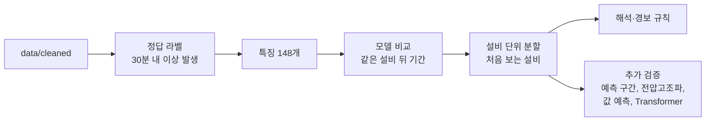
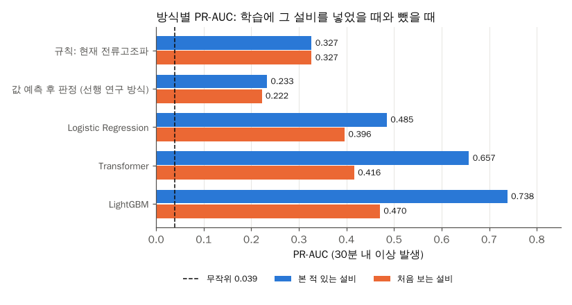
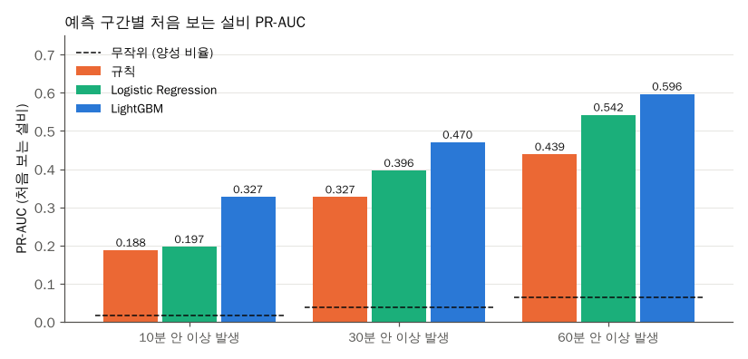
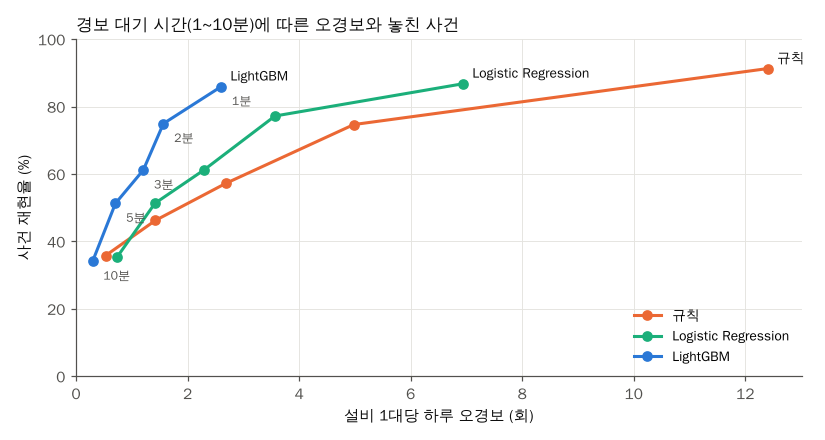

# 머신러닝 기반 전력 설비 상태 진단 및 이상 발생 조기 탐지

> AI-Hub 전력설비 센서 데이터(105대 중 이상 발생이 있는 펌프/일반모터 73대)로 정상 운전 중인 설비가 30분 안에 이상 상태로 바뀔지 예측하고, 학습에 없던 설비에서도 단순 규칙보다 나은지 검증한 졸업논문 코드

## 연구 질문

- 지금 정상으로 운전 중인 설비가 앞으로 30분 안에 전류고조파 이상(주의/경고)으로 바뀌는지 미리 알 수 있는가
- 어떤 측정 항목의 변화가 이상 발생을 예고하는가
- 학습에 없던 설비에서도 단순 규칙보다 나은가

## 핵심 결과

- 학습에 없던 설비에서 30분 내 이상 발생 예측 PR-AUC는 LightGBM 0.470, 전류고조파 임계값 규칙 0.327(무작위 0.039)이었다. 같은 설비의 뒤 기간 평가(0.738)보다 36% 낮고, 이 차이가 설비를 외운 효과이다.
- 예측 구간(10/30/60분)과 라벨(전압고조파)을 바꿔도 학습에 없던 설비에서 LightGBM이 규칙보다 높았다. 묶음 20개 중 19개에서 우세했다.
- 선행 연구처럼 값을 먼저 예측하고 기준값으로 판정하면 PR-AUC 0.222로 규칙보다도 낮았다. 실제 값을 그대로 써도 0.323이 상한이라, 전환 자체를 직접 분류해야 한다.
- 원시 60분 시계열을 직접 보는 작은 Transformer는 학습에 없던 설비 PR-AUC 0.416으로 특징 기반 LightGBM(0.470)보다 낮았다.
- LightGBM 하이퍼파라미터를 평가 설비를 뺀 중첩 교차검증으로 고르면 학습에 없던 설비 PR-AUC는 0.480으로 기본 설정보다 2% 높은 데 그쳤다.

## 데이터

| 항목 | 내용 |
| --- | --- |
| 출처 | AI-Hub 전력설비 라벨링 데이터 |
| 기간 | 2020-09-16 ~ 2021-02-08 |
| 규모 | 설비 105대 (펌프/일반모터 73대, 공조설비 32대), 약 394만 행 |
| 분석 대상 | 펌프/일반모터 73대. 공조설비는 30분 내 이상 발생이 Training 19건, Validation 0건이라 평가할 수 없어 제외 |
| 분할 | 같은 설비를 기간으로 나눈 Training / Validation |
| 주요 컬럼 | 상별 전류·전압·유효/무효전력·역률·고조파, 평균값, 온도, 주파수 |
| 라벨 | 기동패턴 2종(값: Stop/Loading/Unloading), SOH진단 3종(값: 정상/주의/경고) |
| 샘플링 주기 | 1분 |

원본과 변환 결과는 용량 문제로 저장소에 올리지 않는다.

조기 경보 데이터셋(펌프/일반모터)은 예측 대상 시점 Training 950,414행, Validation 133,322행이고, 30분 내 이상 발생 양성 비율은 3.3% / 3.9%, 특징은 148개이다.

## 전처리

1차로 설비 1대의 JSON 5개를 합쳐 설비별 표 1개로 만들고, 2차로 EDA에서 찾은 결측과 이상값을 정리했다. 자세한 내용은 [docs/preprocessing.md](docs/preprocessing.md)에 정리했다.


1차 결과를 EDA로 점검한 뒤 기준을 정해 2차 전처리를 했다. 설비 105대, 약 394만 행을 1분 단위 "시각 × 측정항목 35개 + 라벨 5개" 표로 바꾸고, 결측·이상값을 정리해 209개 파일 401만 행으로 확정했다.

- SOH 라벨은 같은 시각 평균값에 고정 경계(역률 0.6/0.8, 전류고조파 30/60, 전압고조파 3/5)를 적용한 규칙 라벨이다. 운전 구간에서 경계만으로 97~99%가 재현된다.
- 역률 SOH "경고"는 정지 구간의 93%에 붙어 있어 설비 상태가 아니라 정지 여부를 반영한다.

- 결측치: 1분 격자에 맞추고 빈 분은 행으로 추가했다. 5분 이하 끊김만 선형 보간하고 더 긴 끊김(1시간 이상 73곳)은 결측으로 남겼다.
- 이상치: 전류 측정 상한값(512, 4095.94 A), 상전압 500 V 초과, 전원이 들어온 상태의 주파수 55~65 Hz 밖은 결측으로 바꿨다. 음수 전력·역률은 특정 설비에서 일관되게 나와 그대로 뒀다.
- 제외 구간: 전원이 95% 이상 꺼져 있던 Validation 80번 파일을 뺐다. 정지 구간은 지우지 않고 `flag_power_off`와 기동 라벨로 구분한다.
- 스케일링: 모델 단계에서 Training 기준으로 한다.

## 분석 방법

1. EDA: 210개 파일 전체에서 시간 간격, 결측, 0값·음수값, 측정 상한값, 라벨 분포와 라벨끼리의 관계를 집계했다. ([docs/eda.md](docs/eda.md))
2. 2차 전처리: EDA 결과로 기준을 정해 잘못된 값만 결측으로 바꾸고 표시 컬럼을 남겼다. ([docs/preprocessing.md](docs/preprocessing.md#2차-전처리))
3. 문제 정의와 정답 라벨: 현재 라벨 분류 대신 "정상 운전 중 30분 내 이상 발생" 이진 분류로 정하고 정답을 만들었다. ([docs/problem-definition.md](docs/problem-definition.md))
4. 특징 생성: 그 시점까지의 값으로 최근 10/30/60분 통계, 상간 불균형, 최근 이상 이력 등 148개를 만들었다.
5. 모델 비교: 규칙, Logistic Regression, Random Forest, LightGBM을 같은 기간 분할에서 비교했다.
6. 일반화 검증: 설비를 5묶음으로 나눠 학습에 없던 설비에서 다시 평가했다. 예측 구간(10/60분), 라벨(전압고조파), 설비별 z 특징, 선행 연구 방식(값 예측 후 판정), Transformer를 모두 이 틀로 비교했다.
7. 해석과 운영: SHAP으로 모델이 본 신호를 확인하고, 연속 경보 규칙으로 오경보와 놓친 사건의 균형을 봤다.



모델 비교는 같은 설비의 뒤 기간으로 하고, 결론은 학습에 없던 설비 기준 결과로 내린다.

조기 경보 기준과 근거는 아래와 같다.

| 기준 | 정한 값 | 근거 |
| --- | --- | --- |
| 운전 구간 | 기동 라벨이 Stop이 아닌 행 | 전류 > 0 기준이면 Stop 대기 전류(중앙값 2.1 A) 구간 6.4%가 섞이고, 이 구간은 고조파 '주의'가 28.8%로 부풀려져 있다 |
| 이상 발생 | 5분 이상 이어진 주의/경고의 시작 | 이상 구간의 48%가 5분 미만 깜빡임이다 |
| 예측 구간 | 30분 (10분, 60분은 추가 실험) | 펌프/일반모터 Training 양성 비율 10분 1.6%, 30분 3.3%, 60분 4.9%. 10분은 리드 타임 중앙값 6분, 60분은 하루 오경보가 가장 많음 ([예측 구간 비교](case-studies/horizon-comparison.md)) |
| 라벨 | 전류고조파 SOH (전압고조파는 보조) | 전압고조파는 정지 중에도 경고 29%, 주의 24%라 설비 자체 상태를 덜 반영한다 |

| 선택 | 대안 | 고른 이유 | 포기한 점 |
| --- | --- | --- | --- |
| 이상값을 결측으로 바꾸고 표시 | 이상값이 있는 행 삭제 | 1분 격자가 유지되어 윈도우를 자를 때 시간이 어긋나지 않는다 | 결측이 섞인 행을 모델 단계에서 따로 걸러야 한다 |
| 측정 범위·정격 기준 규칙 | 설비별 IQR | 정지/운전이 섞여 분포가 두 봉우리라 IQR이면 운전 구간 전체가 이상치로 잡힌다 | 범위 안에서 튀는 값은 못 잡는다 |
| 5분 이하만 보간 | 모든 결측 보간 | 긴 끊김을 채우면 없는 운전 패턴이 생긴다 | 결측 행 95,967행(2.4%)이 남는다 |
| 정지 구간 유지 | 정지 구간 삭제 | 기동 패턴 분석에 정지 → 운전 전환이 필요하다 | SOH 분석 때는 운전 구간만 따로 골라야 한다 |

모델 단계의 선택은 아래와 같다.

| 선택 | 대안 | 고른 이유 | 포기한 점 |
| --- | --- | --- | --- |
| 전환 직접 분류 | 값 예측 후 기준값 판정 | 값 예측은 5분 미만 깜빡임과 이상을 가르지 못해 PR-AUC 상한이 0.323 | 앞으로의 값 자체는 알려 주지 않는다 |
| LightGBM | Transformer | 같은 평가 틀에서 Transformer는 처음 보는 설비 PR-AUC 0.416으로 더 낮았고, GPU 없이 학습에 2시간이 걸림 | 원시 시계열을 직접 보는 모델의 장점 |
| 처음 보는 설비 기준으로 결론 | 같은 설비 뒤 기간 기준 | 새 설비에 쓸 때의 성능을 부풀리지 않음 | 보고하는 수치가 0.738에서 0.470으로 낮아진다 |
| 기본 설정 LightGBM | 탐색으로 고른 설정 | 중첩 교차검증에서 차이가 +0.010으로 묶음별 편차보다 작고, 묶음마다 고른 설정이 달랐음 | 사건 재현율 3.6%p, 하루 오경보 0.2회의 소폭 개선 |
| 기존 특징 148개 | 설비별 z 특징 추가 | z 특징을 넣으면 처음 보는 설비 PR-AUC가 0.441로 낮아짐 | 하루 오경보 1회 감소 |

## 실험 기록

### 1. 베이스라인 비교
[case-studies/baseline-comparison.md](case-studies/baseline-comparison.md)

"전류고조파가 일정 값을 넘으면 경보"하는 단순 규칙과 특징 148개를 쓴 Logistic Regression을 같은 기준으로 비교했다. 규칙만으로도 PR-AUC 0.327(무작위 0.039)이 나왔고, Logistic Regression은 0.487로 더 높았다. 이후 모델은 규칙 대비 개선 폭으로 보고한다.

핵심 질문:
- 단순 임계값 규칙은 어디까지 맞히는가
- 여러 특징을 함께 쓰면 규칙보다 나아지는가
- 이상 발생 몇 분 전에, 오경보 몇 번으로 잡는가

### 2. 모델 비교
[case-studies/model-comparison.md](case-studies/model-comparison.md)

Random Forest와 LightGBM을 규칙, Logistic Regression과 같은 조건에서 비교했다. LightGBM이 PR-AUC 0.738로 가장 높았고, 하루 오경보는 규칙 16.6회에서 3.5회로 줄었다. 이상 이력이 없는 시점을 따로 표시하는 방식도 함께 정했다.

핵심 질문:
- 트리 모델이 선형 모델보다 얼마나 나은가
- 모델은 어떤 신호를 주로 보는가
- 이상 이력이 없는 시점은 어떻게 다루는가

### 3. 설비 단위 분할
[case-studies/unit-split.md](case-studies/unit-split.md)

설비를 5묶음으로 나눠, 같은 평가 행에서 그 설비를 학습에 넣었을 때와 뺐을 때를 비교했다. 처음 보는 설비에서 LightGBM PR-AUC는 0.470으로 떨어졌지만 규칙(0.327)보다는 높았고 5묶음 중 4묶음에서 우세했다.

핵심 질문:
- 같은 설비 기간 분할 성능 중 설비를 외운 효과는 얼마인가
- 처음 보는 설비에서도 규칙보다 나은가
- 묶음마다 결과가 얼마나 흔들리는가

### 4. 연속 경보 규칙
[case-studies/alarm-rule.md](case-studies/alarm-rule.md)

경보가 N분 이어질 때만 알리는 방식으로 오경보를 줄였다. LightGBM은 2분 대기에서 사건 재현율 73.8%, 하루 오경보 2.0회였고, 비슷한 오경보 수준에서 규칙보다 사건을 27.6%p 더 잡았다.

핵심 질문:
- 대기 시간을 늘리면 오경보와 놓친 사건이 어떻게 바뀌는가
- 오경보 수준을 맞추면 모델 간 차이는 얼마인가

### 5. 설비별 평소 값 대비 특징
[case-studies/unit-normalization.md](case-studies/unit-normalization.md)

값을 그 설비의 과거 평균·표준편차로 나눈 z 특징 33개를 더해 처음 보는 설비 성능을 올리려 했다. LightGBM은 0.470에서 0.441로 오히려 낮아졌고 Logistic Regression만 0.396에서 0.421로 올랐다. 주 실험은 기존 특징을 유지했다.

핵심 질문:
- 설비마다 다른 평소 수준을 맞추면 새 설비에서도 같은 기준이 통하는가
- 왜 트리 모델에서는 효과가 없었는가

### 6. SHAP 해석
[case-studies/shap-interpretation.md](case-studies/shap-interpretation.md)

LightGBM 예측을 특징별 기여로 나눴다. 마지막 이상 후 지난 분(27.4%)과 최근 60분 전류고조파 최댓값(21.3%)이 절반 가까이를 차지했다. 이상 이력이 한 번이라도 있으면 지난 시간과 상관없이 경보 쪽으로 크게 올렸다.

핵심 질문:
- 모델은 어떤 신호를 보고 경보를 내는가
- 전류고조파 외 측정 항목에서 배운 것이 있는가
- 처음 보는 설비 성능이 떨어진 이유와 맞는가

### 7. 예측 구간 비교
[case-studies/horizon-comparison.md](case-studies/horizon-comparison.md)

정답을 10분, 60분 안 이상 발생으로 바꿔 같은 분할 평가를 반복했다. 처음 보는 설비 LightGBM PR-AUC는 10분 0.327, 60분 0.596으로 세 구간 모두 규칙보다 높았다. 구간이 짧을수록 규칙 대비 배수와 설비를 외운 효과가 모두 컸다.

핵심 질문:
- 예측 구간을 바꿔도 결론이 유지되는가
- 구간이 짧아지면 무엇이 어려워지는가
- 주 구간 30분은 적절한가

### 8. 전압고조파 보조 실험
[case-studies/voltage-harmonic.md](case-studies/voltage-harmonic.md)

정답을 전압고조파 SOH 기준으로 바꿔 같은 틀을 적용했다. 처음 보는 설비에서 LightGBM PR-AUC 0.645로 전압고조파 규칙(0.402)보다 60% 높았고 5묶음 모두에서 우세했다.

핵심 질문:
- 다른 이상 종류에도 같은 틀이 통하는가
- 본 적 있는 설비 대비 하락 폭은 전류고조파와 다른가

### 9. 선행 연구 방식 재현: 값 예측 후 판정
[case-studies/value-forecast.md](case-studies/value-forecast.md)

같은 데이터의 선행 연구(이제혁, 2023)처럼 다음 30분 전류고조파 최댓값을 예측하고 기준값 30으로 판정했다. 처음 보는 설비 PR-AUC는 0.222로 규칙(0.327)보다 낮았다. 실제 값을 그대로 써도 0.323으로, 5분 미만 깜빡임과 이상을 가를 수 없는 것이 원인이었다.

핵심 질문:
- 값 예측과 전환 직접 분류 중 조기 경보에 맞는 방식은 무엇인가
- 값 예측이 완벽하면 어디까지 맞히는가

### 10. Transformer 비교
[case-studies/transformer.md](case-studies/transformer.md)

최근 60분 원시값 13채널을 5분 묶음 토큰 12개로 넣는 작은 Transformer(PatchTST 방식)를 같은 5묶음 틀로 평가했다. 처음 보는 설비 PR-AUC 0.416으로 Logistic Regression(0.396)보다는 높고 LightGBM(0.470)보다 11% 낮았다. 본 적 있는 설비 대비 하락 폭(37%)도 LightGBM(36%)과 비슷했다.

핵심 질문:
- 원시 시계열을 직접 보는 딥러닝 모델이 특징 기반 LightGBM보다 나은가
- 처음 보는 설비에서도 같은 순서가 유지되는가

### 11. LightGBM 하이퍼파라미터 탐색
[case-studies/tuning.md](case-studies/tuning.md)

설정 21개를 Training 기간 안에서만 설비 묶음 교차검증으로 채점해 골랐다. 고른 설정은 처음 보는 설비 PR-AUC 0.544였지만, 평가 묶음 설비를 설정 선택에서도 뺀 중첩 교차검증에서는 0.480으로 기본 설정(0.470)과 차이가 작았다. 묶음마다 다른 후보가 뽑혀 주 결과는 기본 설정으로 유지했다.

핵심 질문:
- 설비를 덜 외우는 설정으로 처음 보는 설비 성능을 올릴 수 있는가
- 설정 선택에 평가 설비가 섞이면 성능이 얼마나 부풀려지는가
- 고른 설정이 설비 묶음이 바뀌어도 유지되는가

## 결과와 해석



처음 보는 설비(주황)에서도 LightGBM이 가장 높았고, 선행 연구 방식(값 예측 후 판정)은 규칙보다 낮았다. 모든 방법이 학습에 그 설비를 뺐을 때 성능이 떨어졌다. 규칙은 학습이 없어 두 막대가 같다.



예측 구간을 10분, 60분으로 바꿔도 처음 보는 설비에서 LightGBM이 규칙보다 높았다. 구간이 짧을수록 차이가 컸다.



같은 오경보 수준에서 LightGBM이 규칙보다 많은 사건을 미리 잡았다. 대기 시간은 현장이 오경보와 놓친 사건 중 무엇을 더 꺼리는지에 따라 고른다.

모델별 PR-AUC, 본 적 있는 설비와 처음 보는 설비 비교, SHAP 그래프는 각 실험 기록에 있다. EDA 그래프와 해석은 [docs/eda.md](docs/eda.md)에 정리했다.

## 한계와 다음 계획

- 공조설비는 30분 내 이상 발생이 Training 19건, Validation 0건뿐이라 분석에서 뺐다. 결론은 펌프/일반모터 설비에 대한 것이다.
- 이상 발생 사건의 47%가 상위 5대 설비에 몰려 있다. 설비 단위 분할은 양성 수 순서로 묶음에 배정해 이 쏠림을 나눴지만, 묶음별 편차가 크다(처음 보는 설비 LightGBM 0.325~0.863).
- 처음 보는 설비에서 LightGBM 하루 오경보는 8.4회로 같은 설비 평가(3.5회)의 두 배가 넘는다. 새 설비에는 임계값을 다시 맞춰야 한다.
- SHAP 기여의 48.7%가 최근 이상 이력과 최근 60분 전류고조파 최댓값에서 나왔다. 라벨이 전류고조파 경계로 정해지므로, 다른 측정 항목에서 이상 징후를 미리 읽었다고 주장할 근거는 약하다.
- 설비별 z 특징은 처음 보는 설비 성능을 올리지 못했다. 정격 같은 설비 정보로 맞추는 방식은 데이터에 정보가 없어 시도하지 못했다.
- Transformer는 GPU 없이 작은 모델(차원 64, 2층)을 최대 10 epoch만 학습했다. 6번 중 2번은 최대 epoch에 닿아, 더 큰 설정에서 결과가 달라질 수 있다.
- 음수 유효전력 설비 4대(363, 406, 467, 548번)를 부호 반전할지 정하지 않았다.
- 하이퍼파라미터 탐색은 무작위 21개만 봤다. 중첩 교차검증에서 개선 폭이 작아 더 넓게 찾지 않았다.
- 다음 단계: 새 설비 초기 며칠로 임계값만 다시 맞추는 방식, 10분 예측용 짧은 창 특징

## 실행 방법

```bash
git clone https://github.com/RuruPark/sch_thesis.git
cd sch_thesis
pip install -r requirements.txt
python scripts/01_preprocess.py --raw-dir "<원본 데이터 폴더>"
python scripts/01b_export_csv.py
python scripts/02_eda.py
python scripts/03_clean.py
python scripts/04_make_target.py
python scripts/05_make_features.py
python scripts/06_baseline.py
python scripts/07_model_compare.py
python scripts/08_unit_split.py
python scripts/09_alarm_rule.py
python scripts/10_charts.py
python scripts/12_shap.py
python scripts/13_value_forecast.py
python scripts/14_transformer.py
python scripts/15_tune.py
python scripts/16_tune_nested.py

# 추가 실험: 설비별 z 특징, 예측 구간, 전압고조파 라벨
python scripts/08_unit_split.py --norm --tag norm
python scripts/08_unit_split.py --target target_10 --tag h10
python scripts/08_unit_split.py --target target_60 --tag h60
python scripts/04_make_target.py --soh label_SOH_전압고조파평균 --dst data/target_vh
python scripts/05_make_features.py --target data/target_vh --dst data/features_vh
python scripts/08_unit_split.py --src data/features_vh --rule-col 전압고조파평균 --tag vh
python scripts/10_charts.py
```

발표용 표와 그래프는 위 스크립트를 모두 돌린 뒤 `notebooks/01_presentation.ipynb`를 위에서부터 실행하면 `data/` 아래 결과 파일에서 읽어 `charts/presentation/`에 다시 만든다.

12~16번은 08번이 만든 `data/results/unit_split_assign.csv`(묶음 배정)를 쓰므로 08번 뒤에 실행한다. 16번은 15번의 후보 목록(`tune_search.csv`)을 쓰므로 15번 뒤에 실행한다. 4코어 CPU에서 14번은 약 2시간, 15번은 약 45분, 16번은 약 2시간 걸렸다.

## 폴더 구조

```text
sch_thesis/
+-- README.md
+-- CLAUDE.md              # Claude 작업 지침
+-- case-studies/
|   +-- baseline-comparison.md # 규칙 vs Logistic Regression
|   +-- model-comparison.md # Random Forest, LightGBM 비교
|   +-- unit-split.md      # 처음 보는 설비 평가
|   +-- alarm-rule.md      # 연속 경보 대기 시간
|   +-- unit-normalization.md # 설비별 z 특징
|   +-- shap-interpretation.md # SHAP 해석
|   +-- horizon-comparison.md # 10/30/60분 예측 구간
|   +-- voltage-harmonic.md # 전압고조파 라벨 보조 실험
|   +-- value-forecast.md  # 선행 연구 방식(값 예측 후 판정) 재현
|   +-- transformer.md     # Transformer 비교
+-- docs/
|   +-- CONVENTIONS.md     # 정리 규칙
|   +-- preprocessing.md   # 전처리 기록 (1차, 2차)
|   +-- eda.md             # EDA 기록
|   +-- troubleshooting.md # 막혔던 문제 (STAR)
|   +-- problem-definition.md # 조기 경보 문제 정의와 기준 근거
|   +-- metrics.md         # 지표 정리
+-- scripts/
|   +-- 01_preprocess.py   # 원본 JSON → 설비별 parquet
|   +-- 01b_export_csv.py  # parquet → csv.gz 사본
|   +-- 02_eda.py          # 결측·이상값·라벨 점검, 그래프
|   +-- 03_clean.py        # 2차 전처리
|   +-- 04_make_target.py  # 30분 내 이상 발생 정답 라벨
|   +-- 05_make_features.py # 모델 입력 특징 148개
|   +-- 06_baseline.py     # 베이스라인 비교
|   +-- 07_model_compare.py # Random Forest, LightGBM 비교
|   +-- 08_unit_split.py   # 설비 단위 5묶음 분할 평가 (예측 구간, z 특징, 라벨 바꿔 반복)
|   +-- 09_alarm_rule.py   # 연속 경보 대기 시간 비교
|   +-- 10_charts.py       # 실험 결과 그래프
|   +-- 12_shap.py         # LightGBM SHAP 해석
|   +-- 13_value_forecast.py # 값 예측 후 판정 방식 재현
|   +-- 14_transformer.py  # Transformer 비교 모델
|   +-- 15_tune.py         # LightGBM 하이퍼파라미터 탐색
|   +-- 16_tune_nested.py  # 중첩 교차검증으로 튜닝 효과 확인
|   +-- evaluate.py        # 06번 이후 공통 함수 (데이터 읽기, 임계값, 지표)
+-- notebooks/
|   +-- 01_presentation.ipynb # 발표용 표와 그래프 (결과 파일에서 읽음)
+-- charts/                # README와 문서에 넣는 그래프 (presentation/은 발표용)
+-- data/                  # git에 올리지 않음
|   +-- raw/               # 원본
|   +-- processed/         # 1차 결과 parquet + meta.csv
|   +-- processed_csv/     # csv.gz
|   +-- eda/               # EDA 집계표
|   +-- cleaned/           # 2차 결과 parquet + clean_log.csv
|   +-- target/            # 설비별 정답 라벨 + target_summary.csv
|   +-- features/          # 설비별 특징 parquet (예측 대상 시점만)
|   +-- target_vh/, features_vh/ # 전압고조파 기준 라벨과 특징
|   +-- results/           # 실험 결과표
+-- requirements.txt
+-- .gitignore
```

## 작업 기록

| 날짜 | 한 일 | 관련 문서 |
| --- | --- | --- |
| 2026-10-10 | 원본 JSON을 설비별 parquet로 변환, 정리 규칙 작성 | [preprocessing.md](docs/preprocessing.md), [CONVENTIONS.md](docs/CONVENTIONS.md) |
| 2026-10-10 | 전체 설비 EDA, SOH 라벨이 규칙 라벨임을 확인 | [eda.md](docs/eda.md), `[기능/EDA]` |
| 2026-10-10 | 2차 전처리(1분 격자, 측정 상한값·전압 튐·주파수 이상 결측화, 5분 이하 보간) | [preprocessing.md](docs/preprocessing.md#2차-전처리), [troubleshooting.md](docs/troubleshooting.md), `[기능/전처리]` |
| 2026-10-10 | 조기 경보 문제 정의 확정, 정답 라벨과 특징 148개 생성 | [problem-definition.md](docs/problem-definition.md), `[기능/전처리]`, `[기능/특징]` |
| 2026-10-10 | 베이스라인 비교(항상 음성, 전류고조파 규칙, Logistic Regression) | [baseline-comparison.md](case-studies/baseline-comparison.md), `[실험/모델]` |
| 2026-10-10 | Random Forest·LightGBM 비교, 설비 단위 분할 평가, 연속 경보 규칙 비교 | [model-comparison.md](case-studies/model-comparison.md), [unit-split.md](case-studies/unit-split.md), [alarm-rule.md](case-studies/alarm-rule.md), `[실험/모델]` |
| 2026-10-13 | 공조설비를 빼고 펌프/일반모터 기준으로 06~09번 다시 계산 | `[실험/모델] 평가 대상을 펌프·일반모터 설비로 한정` |
| 2026-10-13 | 설비별 z 특징, SHAP, 10/60분 예측 구간, 전압고조파 라벨 실험 | [unit-normalization.md](case-studies/unit-normalization.md), [shap-interpretation.md](case-studies/shap-interpretation.md), [horizon-comparison.md](case-studies/horizon-comparison.md), [voltage-harmonic.md](case-studies/voltage-harmonic.md) |
| 2026-10-13 | 선행 연구 방식(값 예측 후 판정) 재현, Transformer 비교 | [value-forecast.md](case-studies/value-forecast.md), [transformer.md](case-studies/transformer.md) |
| 2026-10-19 | 발표용 표·그래프 노트북, LightGBM 하이퍼파라미터 탐색과 중첩 교차검증 | [tuning.md](case-studies/tuning.md), `[실험/모델]` |
