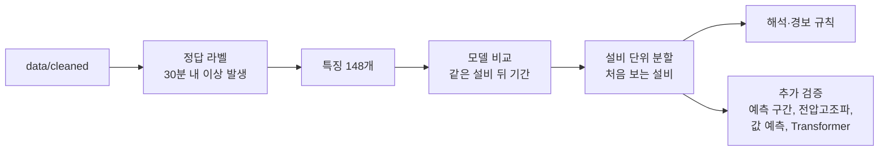
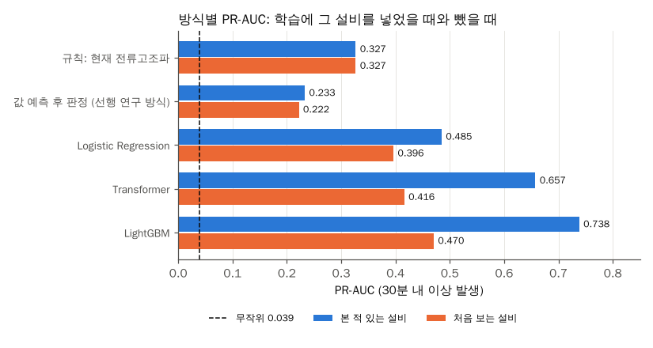
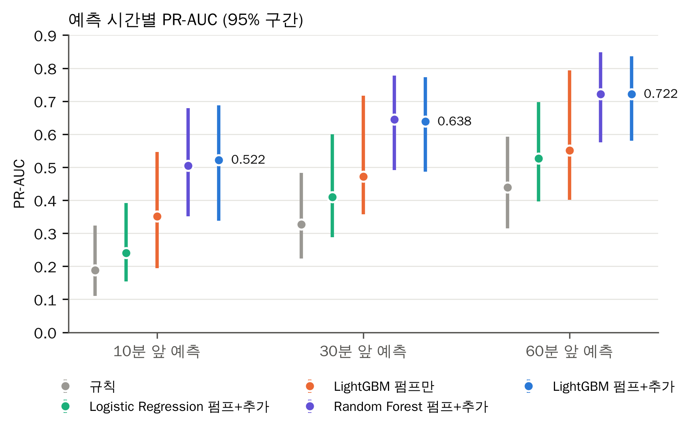
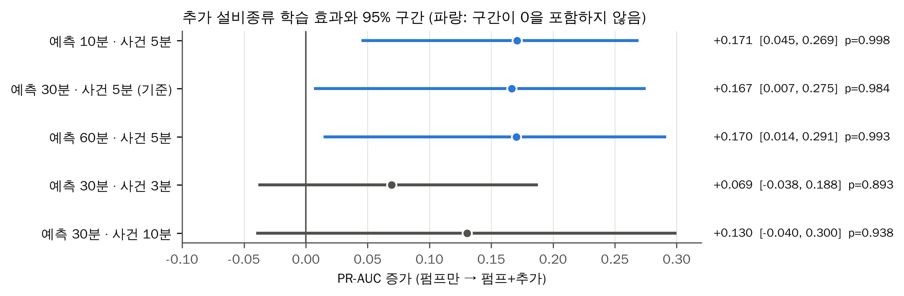
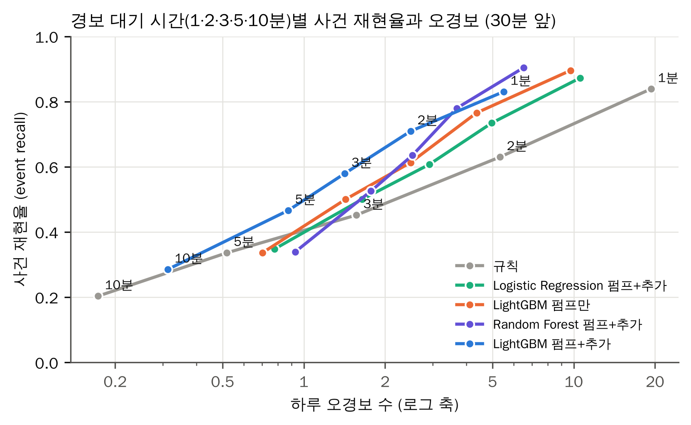

# 머신러닝 기반 전력 설비 상태 진단 및 이상 발생 조기 탐지

> AI-Hub 전력설비 센서 데이터(105대 중 이상 발생이 있는 펌프/일반모터 73대)로 정상 운전 중인 설비가 30분 안에 이상 상태로 바뀔지 예측하고, 학습에 없던 설비에서도 단순 규칙보다 나은지 검증한 졸업논문 코드

## 연구 질문

- 지금 정상으로 운전 중인 설비가 앞으로 30분 안에 전류고조파 이상(주의/경고)으로 바뀌는지 미리 알 수 있는가
- 어떤 측정 항목의 변화가 이상 발생을 예고하는가
- 학습에 없던 설비에서도 단순 규칙보다 나은가

## 핵심 결과

- 압축만 받아 두던 설비종류 6종(322대)을 학습에 더하고 상별 고조파·하루 이력 특징 19개를 보강하자, 학습에 없던 펌프/일반모터 설비 PR-AUC가 0.472에서 0.638로 올랐다(설비 단위 95% 구간 차이 +0.007~+0.275). 10분, 60분 예측에서도 +0.17로 같았다. [model-comparison-v2.md](case-studies/model-comparison-v2.md)
- 같은 조건에서 LightGBM(0.638)은 규칙(0.327)과 Logistic Regression(0.410)보다 확실히 높았고, Random Forest(0.645)와는 차이가 없었다. 2분 대기 경보로 사건 70.9%를 하루 오경보 2.5회로 잡았다.
- 평가 대상을 7종으로 넓혀도 전체 종류 학습이 7종 모두에서 같은 종류만 학습보다 높았다(평균 0.497 → 0.593). 구간으로 확실한 것은 설비가 적거나 이상 있는 설비가 적은 가열로·펌프·공기압축기였다. [widen-evaluation.md](case-studies/widen-evaluation.md)
- 이상 지속 기준을 3/10분으로 바꿔도 모델은 규칙보다 높았지만, 데이터 추가 효과는 5분 기준에서만 유의했다. 설비종류를 하나씩 빼도 0.60 이상이라 효과는 한 종류에 기대지 않았다. [event-duration.md](case-studies/event-duration.md), [leave-one-type-out.md](case-studies/leave-one-type-out.md)
- 펌프만 학습한 기준 모델에서는 학습에 없던 설비 PR-AUC가 LightGBM 0.470, 규칙 0.327(무작위 0.039)이었다. 같은 설비의 뒤 기간 평가(0.738)보다 36% 낮고, 이 차이가 설비를 외운 효과이다.
- 선행 연구처럼 값을 먼저 예측하고 기준값으로 판정하면 PR-AUC 0.222로 규칙보다도 낮았다(펌프만 학습 기준). 전환 자체를 직접 분류해야 한다.

## 데이터

| 항목 | 내용 |
| --- | --- |
| 출처 | AI-Hub 전력설비 라벨링 데이터 |
| 기간 | 2020-09-16 ~ 2021-02-08 |
| 규모 | 설비 105대 (펌프/일반모터 73대, 공조설비 32대), 약 394만 행 |
| 분석 대상 | 펌프/일반모터 73대. 공조설비는 30분 내 이상 발생이 Training 19건, Validation 0건이라 평가할 수 없어 제외 |
| 분할 | 같은 설비를 기간으로 나눈 Training / Validation |
| 주요 컬럼 | 상별 전류·전압·유효/무효전력·역률·고조파, 평균값, 온도, 주파수 |
| 라벨 | 기동패턴 2종(값: Stop/Loading/Unloading), SOH진단 3종(값: 정상/주의/경고) |
| 샘플링 주기 | 1분 |

원본과 변환 결과는 용량 문제로 저장소에 올리지 않는다.

조기 경보 데이터셋(펌프/일반모터)은 예측 대상 시점 Training 950,414행, Validation 133,322행이고, 30분 내 이상 발생 양성 비율은 3.3% / 3.9%, 특징은 148개이다.

## 전처리

1차로 설비 1대의 JSON 5개를 합쳐 설비별 표 1개로 만들고, 2차로 EDA에서 찾은 결측과 이상값을 정리했다. 자세한 내용은 [docs/preprocessing.md](docs/preprocessing.md)에 정리했다.


1차 결과를 EDA로 점검한 뒤 기준을 정해 2차 전처리를 했다. 설비 105대, 약 394만 행을 1분 단위 "시각 × 측정항목 35개 + 라벨 5개" 표로 바꾸고, 결측·이상값을 정리해 209개 파일 401만 행으로 확정했다.

- SOH 라벨은 같은 시각 평균값에 고정 경계(역률 0.6/0.8, 전류고조파 30/60, 전압고조파 3/5)를 적용한 규칙 라벨이다. 운전 구간에서 경계만으로 97~99%가 재현된다.
- 역률 SOH "경고"는 정지 구간의 93%에 붙어 있어 설비 상태가 아니라 정지 여부를 반영한다.

- 결측치: 1분 격자에 맞추고 빈 분은 행으로 추가했다. 5분 이하 끊김만 선형 보간하고 더 긴 끊김(1시간 이상 73곳)은 결측으로 남겼다.
- 이상치: 전류 측정 상한값(512, 4095.94 A), 상전압 500 V 초과, 전원이 들어온 상태의 주파수 55~65 Hz 밖은 결측으로 바꿨다. 음수 전력·역률은 특정 설비에서 일관되게 나와 그대로 뒀다.
- 제외 구간: 전원이 95% 이상 꺼져 있던 Validation 80번 파일을 뺐다. 정지 구간은 지우지 않고 `flag_power_off`와 기동 라벨로 구분한다.
- 스케일링: 모델 단계에서 Training 기준으로 한다.

## 분석 방법

1. EDA: 210개 파일 전체에서 시간 간격, 결측, 0값·음수값, 측정 상한값, 라벨 분포와 라벨끼리의 관계를 집계했다. ([docs/eda.md](docs/eda.md))
2. 2차 전처리: EDA 결과로 기준을 정해 잘못된 값만 결측으로 바꾸고 표시 컬럼을 남겼다. ([docs/preprocessing.md](docs/preprocessing.md#2차-전처리))
3. 문제 정의와 정답 라벨: 현재 라벨 분류 대신 "정상 운전 중 30분 내 이상 발생" 이진 분류로 정하고 정답을 만들었다. ([docs/problem-definition.md](docs/problem-definition.md))
4. 특징 생성: 그 시점까지의 값으로 최근 10/30/60분 통계, 상간 불균형, 최근 이상 이력 등 148개를 만들었다.
5. 모델 비교: 규칙, Logistic Regression, Random Forest, LightGBM을 같은 기간 분할에서 비교했다.
6. 일반화 검증: 설비를 5묶음으로 나눠 학습에 없던 설비에서 다시 평가했다. 예측 구간(10/60분), 라벨(전압고조파), 설비별 z 특징, 선행 연구 방식(값 예측 후 판정), Transformer를 모두 이 틀로 비교했다.
7. 해석과 운영: SHAP으로 모델이 본 신호를 확인하고, 연속 경보 규칙으로 오경보와 놓친 사건의 균형을 봤다.



모델 비교는 같은 설비의 뒤 기간으로 하고, 결론은 학습에 없던 설비 기준 결과로 내린다.

조기 경보 기준과 근거는 아래와 같다.

| 기준 | 정한 값 | 근거 |
| --- | --- | --- |
| 운전 구간 | 기동 라벨이 Stop이 아닌 행 | 전류 > 0 기준이면 Stop 대기 전류(중앙값 2.1 A) 구간 6.4%가 섞이고, 이 구간은 고조파 '주의'가 28.8%로 부풀려져 있다 |
| 이상 발생 | 5분 이상 이어진 주의/경고의 시작 | 이상 구간의 48%가 5분 미만 깜빡임이다 |
| 예측 구간 | 30분 (10분, 60분은 추가 실험) | 펌프/일반모터 Training 양성 비율 10분 1.6%, 30분 3.3%, 60분 4.9%. 10분은 리드 타임 중앙값 6분, 60분은 하루 오경보가 가장 많음 ([예측 구간 비교](case-studies/horizon-comparison.md)) |
| 라벨 | 전류고조파 SOH (전압고조파는 보조) | 전압고조파는 정지 중에도 경고 29%, 주의 24%라 설비 자체 상태를 덜 반영한다 |

| 선택 | 대안 | 고른 이유 | 포기한 점 |
| --- | --- | --- | --- |
| 이상값을 결측으로 바꾸고 표시 | 이상값이 있는 행 삭제 | 1분 격자가 유지되어 윈도우를 자를 때 시간이 어긋나지 않는다 | 결측이 섞인 행을 모델 단계에서 따로 걸러야 한다 |
| 측정 범위·정격 기준 규칙 | 설비별 IQR | 정지/운전이 섞여 분포가 두 봉우리라 IQR이면 운전 구간 전체가 이상치로 잡힌다 | 범위 안에서 튀는 값은 못 잡는다 |
| 5분 이하만 보간 | 모든 결측 보간 | 긴 끊김을 채우면 없는 운전 패턴이 생긴다 | 결측 행 95,967행(2.4%)이 남는다 |
| 정지 구간 유지 | 정지 구간 삭제 | 기동 패턴 분석에 정지 → 운전 전환이 필요하다 | SOH 분석 때는 운전 구간만 따로 골라야 한다 |

모델 단계의 선택은 아래와 같다.

| 선택 | 대안 | 고른 이유 | 포기한 점 |
| --- | --- | --- | --- |
| 전환 직접 분류 | 값 예측 후 기준값 판정 | 값 예측은 5분 미만 깜빡임과 이상을 가르지 못해 PR-AUC 상한이 0.323 | 앞으로의 값 자체는 알려 주지 않는다 |
| LightGBM | Transformer | 같은 평가 틀에서 Transformer는 처음 보는 설비 PR-AUC 0.416으로 더 낮았고, GPU 없이 학습에 2시간이 걸림 | 원시 시계열을 직접 보는 모델의 장점 |
| 처음 보는 설비 기준으로 결론 | 같은 설비 뒤 기간 기준 | 새 설비에 쓸 때의 성능을 부풀리지 않음 | 보고하는 수치가 0.738에서 0.470으로 낮아진다 |
| 기본 설정 LightGBM | 탐색으로 고른 설정 | 중첩 교차검증에서 차이가 +0.010으로 묶음별 편차보다 작고, 묶음마다 고른 설정이 달랐음 | 사건 재현율 3.6%p, 하루 오경보 0.2회의 소폭 개선 |
| 기존 특징 148개 | 설비별 z 특징 추가 | z 특징을 넣으면 처음 보는 설비 PR-AUC가 0.441로 낮아짐 | 하루 오경보 1회 감소 |

## 실험 기록

주 결론을 받치는 실험만 남겼다. 17개 실험 전체의 요약과 핵심 질문은 [docs/experiments.md](docs/experiments.md)에 있다. PR-AUC는 모두 처음 보는 설비 기준이다.

| 실험 | 핵심 결과 | 문서 |
| --- | --- | --- |
| 베이스라인 비교 | 전류고조파 임계값 규칙만으로 PR-AUC 0.327(무작위 0.039)이다. 이후 모델은 이 규칙 대비로 보고한다 | [baseline-comparison.md](case-studies/baseline-comparison.md) |
| 설비 단위 분할 | 펌프만 학습한 LightGBM은 0.470으로 같은 설비 뒤 기간 평가(0.738)보다 36% 낮지만 규칙보다 높다 | [unit-split.md](case-studies/unit-split.md) |
| 다른 설비종류 추가, 특징 보강 | 설비종류 6종을 학습에 더하고 특징 19개를 보강해 0.636까지 올랐다 | [extra-facilities.md](case-studies/extra-facilities.md), [feature-extension.md](case-studies/feature-extension.md) |
| 새 주 모델 기준 비교 | LightGBM 0.638로 규칙(0.327), LR(0.410)보다 높고 RF(0.645)와는 차이가 없다. 데이터 추가 효과는 10/30/60분 모두 +0.17로 유의했다 | [model-comparison-v2.md](case-studies/model-comparison-v2.md) |
| 평가 대상 넓히기 | 전체 종류 학습이 7종 모두에서 같은 종류만 학습보다 높았다(평균 0.497 → 0.593) | [widen-evaluation.md](case-studies/widen-evaluation.md) |
| 연속 경보 규칙 | 경보가 2분 이어질 때만 알리면 같은 오경보 수준에서 규칙보다 사건을 27.6%p 더 잡는다 | [alarm-rule.md](case-studies/alarm-rule.md) |
| 값 예측 후 판정 | 선행 연구 방식은 0.222로 규칙보다 낮아, 전환을 직접 분류하는 방식을 택했다 | [value-forecast.md](case-studies/value-forecast.md) |

예측 구간, 이상 지속 기준, 설비종류 하나씩 빼기 같은 견고성 확인과 효과가 없었던 시도(z 특징, 하이퍼파라미터 탐색, Transformer)도 docs/experiments.md에 있다.

## 결과와 해석



처음 보는 설비(주황)에서도 LightGBM이 가장 높았고, 선행 연구 방식(값 예측 후 판정)은 규칙보다 낮았다. 모든 방법이 학습에 그 설비를 뺐을 때 성능이 떨어졌다. 규칙은 학습이 없어 두 막대가 같다.



펌프+6종으로 학습한 트리 모델(파랑 LightGBM, 보라 RF)이 10/30/60분 모두 규칙과 LR보다 높았다. 세로 막대는 처음 보는 펌프 설비 60대를 다시 뽑은 95% 구간이다.



다른 설비종류를 함께 학습한 효과는 예측 시간과 관계없이 +0.17이었다. 이상 지속 기준을 3/10분으로 바꾸면 방향은 같지만 구간이 0을 포함했다.



같은 오경보 수준에서 LightGBM이 규칙보다 많은 사건을 미리 잡았다. 대기 시간은 현장이 오경보와 놓친 사건 중 무엇을 더 꺼리는지에 따라 고른다.

모델별 PR-AUC, 본 적 있는 설비와 처음 보는 설비 비교, SHAP 그래프는 각 실험 기록에 있다. EDA 그래프와 해석은 [docs/eda.md](docs/eda.md)에 정리했다.

## 한계와 다음 계획

- 공조설비는 30분 내 이상 발생이 Training 19건, Validation 0건뿐이라 분석에서 뺐다. 보일러와 사출기도 라벨 경계가 덜 맞고 사건이 적어 평가하지 않았다. 7종 평가 중 가열로(8대)와 압출기(12대)는 표본이 작아 참고 수준이다.
- 이상 발생 사건의 47%가 상위 5대 설비에 몰려 있다. 설비 단위 분할은 양성 수 순서로 묶음에 배정해 이 쏠림을 나눴지만, 묶음별 편차가 크다(처음 보는 설비 LightGBM 0.325~0.863).
- 처음 보는 설비에서 LightGBM 하루 오경보는 8.4회로 같은 설비 평가(3.5회)의 두 배가 넘는다. 새 설비에는 임계값을 다시 맞춰야 한다.
- SHAP 기여의 48.7%가 최근 이상 이력과 최근 60분 전류고조파 최댓값에서 나왔다. 라벨이 전류고조파 경계로 정해지므로, 다른 측정 항목에서 이상 징후를 미리 읽었다고 주장할 근거는 약하다.
- 설비별 z 특징은 처음 보는 설비 성능을 올리지 못했다. 정격 같은 설비 정보로 맞추는 방식은 데이터에 정보가 없어 시도하지 못했다.
- Transformer는 GPU 없이 작은 모델(차원 64, 2층)을 최대 10 epoch만 학습했다. 6번 중 2번은 최대 epoch에 닿아, 더 큰 설정에서 결과가 달라질 수 있다.
- 음수 유효전력 설비 4대(363, 406, 467, 548번)를 부호 반전할지 정하지 않았다.
- 하이퍼파라미터 탐색은 무작위 21개만 봤다. 중첩 교차검증에서 개선 폭이 작아 더 넓게 찾지 않았다.
- 다른 설비종류를 더한 효과는 5분 지속 기준에서만 95% 구간이 0을 넘었고(3분 +0.069, 10분 +0.130), 7종 중 압출기·주조기·열처리·공작기계는 방향만 같았다.
- 새 설비 처음 며칠로 임계값을 다시 맞추는 방식은 효과가 없었다. 처음 보는 설비의 Validation이 설비당 중앙값 2.7일이라 7일 보정은 평가하지 못했다.
- 비교 모델(LR, RF)은 16GB 메모리 때문에 학습 행을 150만 개로 줄였다.
- 다음 단계: 공작기계를 다른 종류와 같은 양으로 줄여 양과 종류의 효과 가르기, 10분 예측용 짧은 창 특징

## 실행 방법

```bash
git clone https://github.com/RuruPark/sch_thesis.git
cd sch_thesis
pip install -r requirements.txt
python scripts/01_preprocess.py --raw-dir "<원본 데이터 폴더>"
python scripts/01b_export_csv.py
python scripts/02_eda.py
python scripts/03_clean.py
python scripts/04_make_target.py
python scripts/05_make_features.py
python scripts/06_baseline.py
python scripts/07_model_compare.py
python scripts/08_unit_split.py
python scripts/09_alarm_rule.py
python scripts/10_charts.py
python scripts/12_shap.py
python scripts/13_value_forecast.py
python scripts/14_transformer.py
python scripts/15_tune.py
python scripts/16_tune_nested.py
python scripts/17_extra_facilities.py --src data/features_v2 --compare --save-scores --tag v2cmp
python scripts/19_unit_bootstrap.py --scores data/results/extra_fac_v2cmp_scores.parquet --tag v2cmp
python scripts/20_threshold_recal.py --scores data/results/extra_fac_v2cmp_scores.parquet --tag v2cmp
python scripts/18_widen_eval.py --src data/features_v2 --save-scores --tag v2s
python scripts/19_unit_bootstrap.py --scores data/results/widen_v2s_scores.parquet --by facility --tag v2s
python scripts/21_thesis_figures.py   # 논문용 그림 charts/thesis_fig*.png(300dpi), .pdf

# 추가 실험: 설비별 z 특징, 예측 구간, 전압고조파 라벨
python scripts/08_unit_split.py --norm --tag norm
python scripts/08_unit_split.py --target target_10 --tag h10
python scripts/08_unit_split.py --target target_60 --tag h60
python scripts/04_make_target.py --soh label_SOH_전압고조파평균 --dst data/target_vh
python scripts/05_make_features.py --target data/target_vh --dst data/features_vh
python scripts/08_unit_split.py --src data/features_vh --rule-col 전압고조파평균 --tag vh
python scripts/10_charts.py
```

발표용 표와 그래프는 위 스크립트를 모두 돌린 뒤 `notebooks/01_presentation.ipynb`를 위에서부터 실행하면 `data/` 아래 결과 파일에서 읽어 `charts/presentation/`에 다시 만든다.

12~16번은 08번이 만든 `data/results/unit_split_assign.csv`(묶음 배정)를 쓰므로 08번 뒤에 실행한다. 16번은 15번의 후보 목록(`tune_search.csv`)을 쓰므로 15번 뒤에 실행한다. 4코어 CPU에서 14번은 약 2시간, 15번은 약 45분, 16번은 약 2시간 걸렸다.

## 폴더 구조

```text
sch_thesis/
+-- README.md
+-- CLAUDE.md              # Claude 작업 지침
+-- case-studies/
|   +-- baseline-comparison.md # 규칙 vs Logistic Regression
|   +-- model-comparison.md # Random Forest, LightGBM 비교
|   +-- unit-split.md      # 처음 보는 설비 평가
|   +-- alarm-rule.md      # 연속 경보 대기 시간
|   +-- unit-normalization.md # 설비별 z 특징
|   +-- shap-interpretation.md # SHAP 해석
|   +-- horizon-comparison.md # 10/30/60분 예측 구간
|   +-- voltage-harmonic.md # 전압고조파 라벨 보조 실험
|   +-- value-forecast.md  # 선행 연구 방식(값 예측 후 판정) 재현
|   +-- transformer.md     # Transformer 비교
+-- docs/
|   +-- CONVENTIONS.md     # 정리 규칙
|   +-- preprocessing.md   # 전처리 기록 (1차, 2차)
|   +-- eda.md             # EDA 기록
|   +-- troubleshooting.md # 막혔던 문제 (STAR)
|   +-- problem-definition.md # 조기 경보 문제 정의와 기준 근거
|   +-- metrics.md         # 지표 정리
|   +-- experiments.md     # 실험별 요약과 핵심 질문
+-- scripts/
|   +-- 01_preprocess.py   # 원본 JSON → 설비별 parquet
|   +-- 01b_export_csv.py  # parquet → csv.gz 사본
|   +-- 02_eda.py          # 결측·이상값·라벨 점검, 그래프
|   +-- 02b_eda_facility.py # 설비종류별 라벨 경계·품질 점검
|   +-- 03_clean.py        # 2차 전처리
|   +-- 04_make_target.py  # 30분 내 이상 발생 정답 라벨
|   +-- 05_make_features.py # 모델 입력 특징 148개 (--extra로 보강 19개 추가)
|   +-- 06_baseline.py     # 베이스라인 비교
|   +-- 07_model_compare.py # Random Forest, LightGBM 비교
|   +-- 08_unit_split.py   # 설비 단위 5묶음 분할 평가 (예측 구간, z 특징, 라벨 바꿔 반복)
|   +-- 09_alarm_rule.py   # 연속 경보 대기 시간 비교
|   +-- 10_charts.py       # 실험 결과 그래프
|   +-- 12_shap.py         # LightGBM SHAP 해석
|   +-- 13_value_forecast.py # 값 예측 후 판정 방식 재현
|   +-- 14_transformer.py  # Transformer 비교 모델
|   +-- 15_tune.py         # LightGBM 하이퍼파라미터 탐색
|   +-- 16_tune_nested.py  # 중첩 교차검증으로 튜닝 효과 확인
|   +-- 17_extra_facilities.py # 다른 설비종류를 학습에 더한 평가, 경보 표, SHAP (--compare로 LR·RF 비교)
|   +-- 18_widen_eval.py   # 설비종류별 처음 보는 설비 평가
|   +-- 19_unit_bootstrap.py # 설비 단위 부트스트랩 신뢰구간
|   +-- 20_threshold_recal.py # 새 설비 처음 며칠 임계값 재보정
|   +-- 21_thesis_figures.py # 논문용 그림 (300dpi png, pdf)
|   +-- evaluate.py        # 06번 이후 공통 함수 (데이터 읽기, 임계값, 지표)
+-- notebooks/
|   +-- 01_presentation.ipynb # 발표용 표와 그래프 (결과 파일에서 읽음)
+-- charts/                # README와 문서에 넣는 그래프 (presentation/은 발표용)
+-- data/                  # git에 올리지 않음
|   +-- raw/               # 원본
|   +-- processed/         # 1차 결과 parquet + meta.csv
|   +-- processed_csv/     # csv.gz
|   +-- eda/               # EDA 집계표
|   +-- cleaned/           # 2차 결과 parquet + clean_log.csv
|   +-- target/            # 설비별 정답 라벨 + target_summary.csv
|   +-- features/          # 설비별 특징 parquet (예측 대상 시점만)
|   +-- target_vh/, features_vh/ # 전압고조파 기준 라벨과 특징
|   +-- results/           # 실험 결과표
+-- requirements.txt
+-- .gitignore
```
