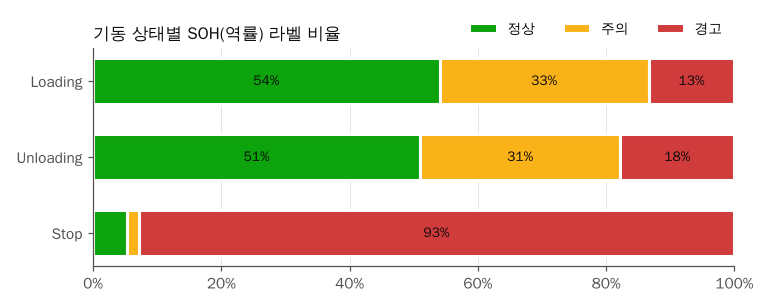
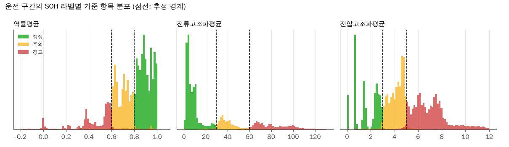
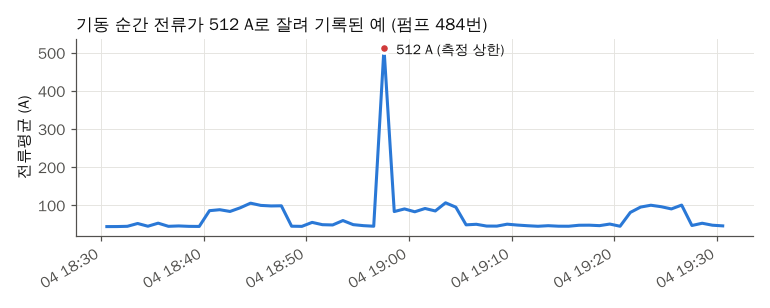

# 머신러닝 기반 전력 설비 상태 진단 및 이상 발생 조기 탐지

> AI-Hub 전력설비 센서 데이터(펌프/일반모터, 공조설비 105대)로 정상 운전 중인 설비가 30분 안에 이상 상태로 바뀔지 예측하는 졸업논문 코드

## 연구 질문

- 지금 정상으로 운전 중인 설비가 앞으로 30분 안에 전류고조파 이상(주의/경고)으로 바뀌는지 미리 알 수 있는가
- 어떤 측정 항목의 변화가 이상 발생을 예고하는가

## 핵심 결과

- 전처리 완료: 설비 105대, 약 394만 행을 1분 단위 "시각 × 측정항목 35개 + 라벨 5개" 표로 변환하고, 결측·이상값을 정리해 209개 파일 401만 행으로 확정
- SOH 라벨은 같은 시각 평균값에 고정 경계(역률 0.6/0.8, 전류고조파 30/60, 전압고조파 3/5)를 적용한 규칙 라벨이다. 운전 구간에서 경계만으로 97~99%가 재현된다
- 역률 SOH "경고"는 정지 구간의 93%에 붙어 있어 설비 상태가 아니라 정지 여부를 반영한다
- 조기 경보 데이터셋 구성: 예측 대상 시점 Training 134만 / Validation 18만, 30분 내 이상 발생 양성 비율 2.3% / 2.9%, 특징 148개 (모델 결과는 진행 후 추가)

## 데이터

| 항목 | 내용 |
| --- | --- |
| 출처 | AI-Hub 전력설비 라벨링 데이터 |
| 기간 | 2020-09-16 ~ 2021-02-08 |
| 규모 | 설비 105대 (펌프/일반모터 73대, 공조설비 32대), 약 394만 행 |
| 분할 | 같은 설비를 기간으로 나눈 Training / Validation |
| 주요 컬럼 | 상별 전류·전압·유효/무효전력·역률·고조파, 평균값, 온도, 주파수 |
| 라벨 | 기동패턴 2종(값: Stop/Loading/Unloading), SOH진단 3종(값: 정상/주의/경고) |
| 샘플링 주기 | 1분 |

원본과 변환 결과는 용량 문제로 저장소에 올리지 않는다.

## 전처리

1차로 설비 1대의 JSON 5개를 합쳐 설비별 표 1개로 만들고, 2차로 EDA에서 찾은 결측과 이상값을 정리했다. 자세한 내용은 [docs/preprocessing.md](docs/preprocessing.md)에 정리했다.


1차 결과를 EDA로 점검한 뒤 기준을 정해 2차 전처리를 했다.

- 결측치: 1분 격자에 맞추고 빈 분은 행으로 추가했다. 5분 이하 끊김만 선형 보간하고 더 긴 끊김(1시간 이상 73곳)은 결측으로 남겼다.
- 이상치: 전류 측정 상한값(512, 4095.94 A), 상전압 500 V 초과, 전원이 들어온 상태의 주파수 55~65 Hz 밖은 결측으로 바꿨다. 음수 전력·역률은 특정 설비에서 일관되게 나와 그대로 뒀다.
- 제외 구간: 전원이 95% 이상 꺼져 있던 Validation 80번 파일을 뺐다. 정지 구간은 지우지 않고 `flag_power_off`와 기동 라벨로 구분한다.
- 스케일링: 모델 단계에서 Training 기준으로 한다.

## 분석 방법

1. EDA: 210개 파일 전체에서 시간 간격, 결측, 0값·음수값, 측정 상한값, 라벨 분포와 라벨끼리의 관계를 집계했다. ([docs/eda.md](docs/eda.md))
2. 2차 전처리: EDA 결과로 기준을 정해 잘못된 값만 결측으로 바꾸고 표시 컬럼을 남겼다. ([docs/preprocessing.md](docs/preprocessing.md#2차-전처리))
3. 문제 정의와 정답 라벨: 현재 라벨 분류 대신 "정상 운전 중 30분 내 이상 발생" 이진 분류로 정하고 정답을 만들었다. ([docs/problem-definition.md](docs/problem-definition.md))
4. 특징 생성: 그 시점까지의 값으로 최근 10/30/60분 통계, 상간 불균형, 최근 이상 이력 등 148개를 만들었다.

조기 경보 기준과 근거는 아래와 같다.

| 기준 | 정한 값 | 근거 |
| --- | --- | --- |
| 운전 구간 | 기동 라벨이 Stop이 아닌 행 | 전류 > 0 기준이면 Stop 대기 전류(중앙값 2.1 A) 구간 6.4%가 섞이고, 이 구간은 고조파 '주의'가 28.8%로 부풀려져 있다 |
| 이상 발생 | 5분 이상 이어진 주의/경고의 시작 | 이상 구간의 48%가 5분 미만 깜빡임이다 |
| 예측 구간 | 30분 (10분, 60분은 추가 실험) | 양성 비율 10분 1.1%, 30분 2.3%, 60분 3.5%. 대응 시간과 예측 가능성의 균형 |
| 라벨 | 전류고조파 SOH (전압고조파는 보조) | 전압고조파는 정지 중에도 경고 29%, 주의 24%라 설비 자체 상태를 덜 반영한다 |

| 선택 | 대안 | 고른 이유 | 포기한 점 |
| --- | --- | --- | --- |
| 이상값을 결측으로 바꾸고 표시 | 이상값이 있는 행 삭제 | 1분 격자가 유지되어 윈도우를 자를 때 시간이 어긋나지 않는다 | 결측이 섞인 행을 모델 단계에서 따로 걸러야 한다 |
| 측정 범위·정격 기준 규칙 | 설비별 IQR | 정지/운전이 섞여 분포가 두 봉우리라 IQR이면 운전 구간 전체가 이상치로 잡힌다 | 범위 안에서 튀는 값은 못 잡는다 |
| 5분 이하만 보간 | 모든 결측 보간 | 긴 끊김을 채우면 없는 운전 패턴이 생긴다 | 결측 행 95,967행(2.4%)이 남는다 |
| 정지 구간 유지 | 정지 구간 삭제 | 기동 패턴 분석에 정지 → 운전 전환이 필요하다 | SOH 분석 때는 운전 구간만 따로 골라야 한다 |

## 결과와 해석



역률 SOH "경고"는 정지 구간의 93%에 붙어 있었다. 멈춰 있으면 역률이 0으로 찍히기 때문이라 SOH 분석은 운전 구간만 쓴다.



운전 구간에서도 SOH 라벨은 기준 항목 값의 고정 경계로 거의 그대로 나뉜다. 그 항목을 입력에 넣고 같은 시각의 SOH를 맞히는 모델은 경계만 배우게 된다.



작업일지에서 의심했던 전류 512 A는 기동 순간 돌입전류가 센서 상한에서 잘린 값이었다.

## 한계와 다음 계획

- 공조설비는 30분 내 이상 발생이 Training 19건, Validation 0건뿐이라 사실상 펌프/일반모터 설비의 문제이다.
- 이상 발생 사건의 47%가 상위 5대 설비에 몰려 있다. 설비 단위 분할 때 사건 수 기준으로 층을 나눠야 한다.
- 음수 유효전력 설비 4대(363, 406, 467, 548번)를 부호 반전할지 정하지 않았다.
- 1시간 넘게 끊긴 73곳은 2021-01-23 ~ 02-08에 몰려 있다. 이 기간을 쓰는 윈도우는 결측 처리 방식을 따로 정해야 한다.
- 다음 단계: 베이스라인("현재 상태 유지", 전류고조파 임계값 규칙, Logistic Regression) 구축 후 RF, GBM 계열 비교

## 실행 방법

```bash
git clone https://github.com/RuruPark/sch_thesis.git
cd sch_thesis
pip install -r requirements.txt
python scripts/01_preprocess.py --raw-dir "<원본 데이터 폴더>"
python scripts/01b_export_csv.py
python scripts/02_eda.py
python scripts/03_clean.py
python scripts/04_make_target.py
python scripts/05_make_features.py
```

## 폴더 구조

```text
sch_thesis/
+-- README.md
+-- CLAUDE.md              # Claude 작업 지침
+-- docs/
|   +-- CONVENTIONS.md     # 정리 규칙
|   +-- preprocessing.md   # 전처리 기록 (1차, 2차)
|   +-- eda.md             # EDA 기록
|   +-- troubleshooting.md # 막혔던 문제 (STAR)
|   +-- problem-definition.md # 조기 경보 문제 정의와 기준 근거
+-- scripts/
|   +-- 01_preprocess.py   # 원본 JSON → 설비별 parquet
|   +-- 01b_export_csv.py  # parquet → csv.gz 사본
|   +-- 02_eda.py          # 결측·이상값·라벨 점검, 그래프
|   +-- 03_clean.py        # 2차 전처리
|   +-- 04_make_target.py  # 30분 내 이상 발생 정답 라벨
|   +-- 05_make_features.py # 모델 입력 특징 148개
+-- charts/                # README와 문서에 넣는 그래프
+-- data/                  # git에 올리지 않음
|   +-- raw/               # 원본
|   +-- processed/         # 1차 결과 parquet + meta.csv
|   +-- processed_csv/     # csv.gz
|   +-- eda/               # EDA 집계표
|   +-- cleaned/           # 2차 결과 parquet + clean_log.csv
|   +-- target/            # 설비별 정답 라벨 + target_summary.csv
|   +-- features/          # 설비별 특징 parquet (예측 대상 시점만)
+-- requirements.txt
+-- .gitignore
```

## 작업 기록

| 날짜 | 한 일 | 관련 문서 |
| --- | --- | --- |
| 2026-10-10 | 원본 JSON을 설비별 parquet로 변환, 정리 규칙 작성 | [preprocessing.md](docs/preprocessing.md), [CONVENTIONS.md](docs/CONVENTIONS.md) |
| 2026-10-10 | 전체 설비 EDA, SOH 라벨이 규칙 라벨임을 확인 | [eda.md](docs/eda.md), `[기능/EDA]` |
| 2026-10-10 | 2차 전처리(1분 격자, 측정 상한값·전압 튐·주파수 이상 결측화, 5분 이하 보간) | [preprocessing.md](docs/preprocessing.md#2차-전처리), [troubleshooting.md](docs/troubleshooting.md), `[기능/전처리]` |
| 2026-10-10 | 조기 경보 문제 정의 확정, 정답 라벨과 특징 148개 생성 | [problem-definition.md](docs/problem-definition.md), `[기능/전처리]`, `[기능/특징]` |
