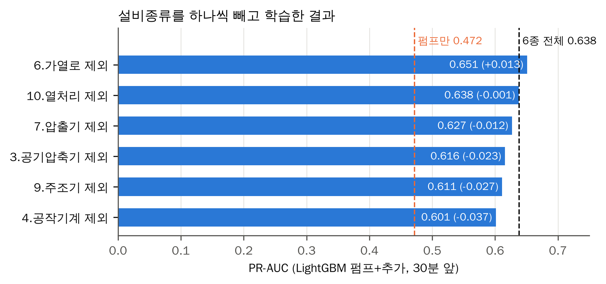

# 설비종류 하나씩 빼기: 어떤 종류를 빼도 처음 보는 펌프 설비 PR-AUC가 0.60 이상이라, 데이터 추가 효과는 한 종류에 기대지 않음

## 문제

다른 설비종류 6종을 학습에 더하자 처음 보는 펌프 설비 PR-AUC가 0.472에서 0.638로 올랐다([model-comparison-v2.md](model-comparison-v2.md)). 이 효과가 특정 설비종류 하나(예: 설비가 가장 많은 공작기계) 덕분인지, 여러 종류가 함께 만든 것인지는 확인하지 않았다.

코드: [scripts/17_extra_facilities.py](../scripts/17_extra_facilities.py) `--types <5종> --only-extra`

## 분석 흐름

```text
data/features_v2 (보강 특징 167개)
→ 6종 중 하나를 뺀 5종 + 펌프로 학습 (6번)
→ 08번과 같은 펌프 5묶음, 처음 보는 펌프 설비로 평가
→ 6종 전체(0.638)와 비교
```

## 목표와 측정 지표

- 한 종류를 빼면 PR-AUC가 펌프만(0.472) 수준으로 떨어지는가
- 어느 종류의 기여가 큰가
- 지표 정의는 [docs/metrics.md](../docs/metrics.md)

## 결과

| 뺀 종류 | 뺀 설비 / 행 | PR-AUC | 6종 전체 대비 | F1 | 하루 오경보 |
| --- | --- | ---: | ---: | ---: | ---: |
| 4. 공작기계 | 138대 / 55.2만 | 0.601 | −0.037 | 0.560 | 8.2 |
| 9. 주조기 | 22대 / 6.3만 | 0.611 | −0.027 | 0.582 | 6.1 |
| 3. 공기압축기 | 67대 / 25.5만 | 0.616 | −0.022 | 0.577 | 6.5 |
| 7. 압출기 | 14대 / 6.6만 | 0.627 | −0.011 | 0.582 | 5.4 |
| 10. 열처리 | 73대 / 24.1만 | 0.638 | 0.000 | 0.588 | 6.0 |
| 6. 가열로 | 7대 / 5.8만 | 0.651 | +0.013 | 0.603 | 5.3 |
| (6종 전체) | | 0.638 | | 0.584 | 5.5 |
| (펌프만) | | 0.472 | | 0.489 | 9.7 |

행 수는 음성 20% 표본추출 뒤 학습에 들어간 행이다. 처음 보는 펌프 설비 60대, 사건 354건, 대기 1분 기준이다.

- 어떤 종류를 빼도 0.601~0.651로, 펌프만보다 0.13 이상 높았다. 효과는 한 종류에 기대지 않았다.
- 공작기계를 빼면 5묶음 모두에서 낮아졌고 하루 오경보도 5.5회에서 8.2회로 늘었다. 다만 공작기계가 추가 데이터의 45%를 차지해, 종류의 효과인지 양의 효과인지는 이 실험만으로 가를 수 없다.
- 주조기는 6만 행뿐인데 빼면 −0.027로 두 번째로 컸다. 양보다 펌프와 비슷한 전조를 가진 종류로 본다.
- 열처리(0.000)와 가열로(+0.013)는 차이가 작다. 종류를 빼면 음성 표본추출 결과도 함께 바뀌어 ±0.01은 그 흔들림 안이다.



여섯 막대가 모두 펌프만 기준선(주황 점선)보다 0.13 이상 오른쪽에 있고, 6종 전체 기준선(검은 점선) 근처에 모였다.

## 판단

- 주 모델은 6종 전체 학습으로 유지한다. 가열로를 빼면 조금 높았지만, 평가 결과를 보고 학습 종류를 고르면 처음 보는 설비 성능이 부풀려진다.
- 논문에는 "효과가 여러 종류에서 고르게 나왔고, 공작기계·주조기·공기압축기의 기여가 컸다"로 쓴다.

## Trade-off

| 선택 | 대안 | 고른 이유 | 포기한 점 |
| --- | --- | --- | --- |
| 한 종류씩 빼기 | 한 종류씩만 더하기 | 6종 전체 모델과 바로 비교되고 실행이 6번으로 끝남 | 종류끼리 겹치는 정보는 따로 보지 못한다 |
| 신뢰구간 없이 합산 PR-AUC만 비교 | 6번 모두 점수 저장 후 부트스트랩 | 차이가 대부분 0.04 이내라 설비 단위 구간(폭 ±0.1 이상) 안에 들 것이 분명함 | 종류별 차이가 유의한지는 말할 수 없다 |

## 다음에 확인할 것

- 공작기계를 다른 종류와 같은 행 수로 줄였을 때의 효과 (양과 종류 가르기)
