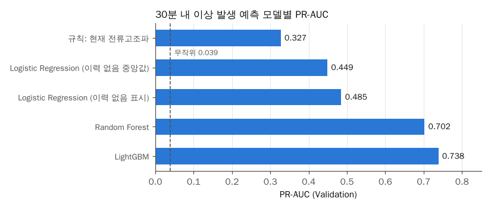

# 모델 비교: Random Forest와 LightGBM이 전류고조파 규칙과 Logistic Regression보다 나은지

## 문제

[베이스라인 비교](baseline-comparison.md)에서 Logistic Regression은 전류고조파 임계값 규칙보다 PR-AUC가 51% 높았다. 선형 모델은 특징끼리의 조합(예: "최근 60분에 전류고조파가 높았고, 지금은 운전한 지 얼마 안 됐다")을 잡지 못한다. 트리 기반 모델이 이런 조합을 잡아 더 나아지는지 확인했다. 함께 "마지막 이상 후 지난 분"이 비어 있는 시점을 어떻게 다룰지도 비교했다.

코드: [scripts/07_model_compare.py](../scripts/07_model_compare.py), 공통 함수 [scripts/evaluate.py](../scripts/evaluate.py)

## 분석 흐름

```text
data/features
→ 설비마다 Training 앞 80% 기간: 학습
→ 설비마다 Training 뒤 20% 기간: 경보 임계값 선택, LightGBM 조기 종료 기준
→ Validation: 평가
```

베이스라인 비교에서는 학습한 행으로 임계값을 골랐다. 트리 모델은 학습한 행에서 점수가 과하게 높게 나와 같은 방식으로 고르면 임계값이 어긋난다. 그래서 이번 실험부터는 학습에 쓰지 않은 뒤 20% 기간에서 임계값을 고른다. 이 때문에 규칙과 Logistic Regression의 정밀도, 재현율 같은 경보 지표는 베이스라인 문서와 조금 다르다.

## 목표와 측정 지표

[베이스라인 비교](baseline-comparison.md)와 같다. 주 지표는 PR-AUC이고, 경보 지표는 사건 재현율과 하루 오경보이다. 정의는 [docs/metrics.md](../docs/metrics.md)에 있다.

## 관찰

1. "마지막 이상 후 지난 분"은 그 설비 파일에서 이상이 한 번도 없었던 시점에 비어 있다(약 70%). 베이스라인에서는 이 칸을 중앙값으로 채웠다. 그러면 "이상 이력 없음"이 "꽤 최근에 이상이 있었음"처럼 보이게 된다.
2. 베이스라인 Logistic Regression에서 계수가 가장 큰 특징이 이 칸이었다(-2.46).

## 가설

- 이상 이력이 없다는 사실을 따로 표시하면 선형 모델도 조금 나아질 것이다.
- 트리 모델은 "최근 전류고조파 최댓값이 경계 근처"와 "최근 이상 이력" 같은 조합을 잡아 선형 모델보다 크게 나아질 것이다.

## 실험

### 실험 1. 이상 이력 없음 표시

`이상이력없음` 열(이력이 없으면 1)을 추가하고, 빈 칸은 학습 기간의 최댓값(가장 오래 전)으로 채웠다. Logistic Regression으로 중앙값 방식과 비교했다.

### 실험 2. Random Forest

트리 200개, 트리마다 학습 행의 10%만 써서 키웠다. 전체 행으로 키울 경우, 4코어 환경에서 한 시간 넘게 걸리는 문제가 있었다. 양성이 적어 `class_weight="balanced_subsample"`을 줬다.

### 실험 3. LightGBM

학습률 0.05, 잎 63개로 두고 뒤 20% 기간의 PR-AUC가 100번 연속 나아지지 않으면 멈췄다. 트리 75개에서 멈췄다.

## 결과



| 방법 | PR-AUC | 정밀도 | 재현율 | F1 | 사건 재현율 | 리드 타임(분) | 하루 오경보 |
| --- | ---: | ---: | ---: | ---: | ---: | ---: | ---: |
| 규칙: 현재 전류고조파 | 0.326 | 0.296 | 0.731 | 0.421 | 91.3% | 13 | 12.4 |
| Logistic Regression (이력 없음 중앙값) | 0.457 | 0.350 | 0.775 | 0.482 | 93.8% | 12 | 8.7 |
| Logistic Regression (이력 없음 표시) | 0.473 | 0.407 | 0.654 | 0.502 | 86.8% | 10.5 | 6.9 |
| Random Forest | 0.694 | 0.572 | 0.703 | 0.631 | 86.2% | 10 | 2.5 |
| LightGBM | **0.722** | **0.637** | 0.654 | **0.645** | 85.9% | 10 | 2.6 |

- 이상 이력 없음 표시는 Logistic Regression PR-AUC를 0.457에서 0.473으로 조금 올렸다.
- LightGBM은 규칙보다 PR-AUC가 0.396 높았다(2.2배). Logistic Regression보다도 0.249 높았다.
- 사건 재현율은 86% 안팎으로 비슷하면서, 하루 오경보는 규칙 12.4회, Logistic Regression 6.9회, LightGBM 2.6회로 줄었다.

LightGBM 중요도(분할 이득 비율) 상위는 최근 60분 전류고조파 최댓값(36.3%), 최근 30분 전류고조파 최댓값(14.6%), 마지막 이상 후 지난 분(8.8%), 최근 30분 전류고조파 평균(3.7%) 순이었다. 지금 값보다 "최근 한 시간 안에 전류고조파가 얼마나 높이 올라갔었는가"가 가장 큰 신호였다.

## 판단

- 이후 실험의 기본 모델은 LightGBM으로 정했다. Random Forest와 PR-AUC 차이는 0.028로 작지만, 학습 시간이 짧고 행을 줄이지 않고 전부 썼다.
- 이상 이력 없음 표시는 이후 실험에 계속 쓴다.
- 중요도 상위 4개 중 3개가 전류고조파 관련 특징이고 합쳐서 54.6%이다. 모델이 배운 것은 대부분 "전류고조파가 최근에 경계 가까이 갔었는가"이다. 논문에서는 이 점을 숨기지 않고, 단순 규칙과의 차이(PR-AUC 0.326 → 0.722)가 여러 창 길이와 이상 이력을 함께 보는 데서 나온다고 쓴다.

## Trade-off

| 선택 | 대안 | 고른 이유 | 포기한 점 |
| --- | --- | --- | --- |
| Training 뒤 20%로 임계값 선택 | 학습 행 전체로 임계값 선택 | 트리 모델의 학습 행 점수가 과하게 높아 임계값이 어긋나는 문제 있음 | 학습 행이 20% 줄었다 |
| LightGBM 기본 설정 + 조기 종료 | 하이퍼파라미터 탐색 | 규칙, 선형 모델과 같은 조건에서 먼저 비교 | 최적값보다 성능이 낮을 수 있다 |
| Random Forest 행 10% 표본 | 전체 행 | 4코어에서 한 시간 넘게 걸리는 문제 있음 | Random Forest 성능이 덜 나왔을 수 있다 |

## 다음에 확인할 것

- 처음 보는 설비에서도 LightGBM이 규칙보다 나은지: [unit-split.md](unit-split.md)
- 오경보를 더 줄이는 경보 규칙: [alarm-rule.md](alarm-rule.md)
- 하이퍼파라미터 탐색과 SHAP으로 특징 해석
