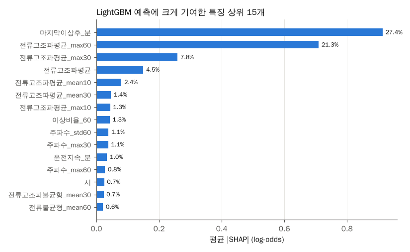
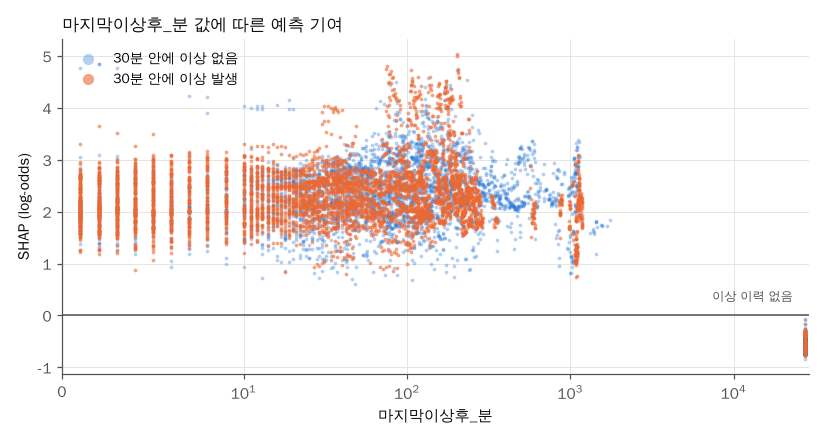

# SHAP 해석: LightGBM은 최근 이상 이력과 최근 60분 전류고조파 최댓값으로 예측함

## 문제

[모델 비교](model-comparison.md)의 분할 이득 중요도는 모델이 어떤 특징으로 트리를 많이 나눴는지만 보여 준다. 특징이 예측을 위로 올리는지 아래로 내리는지는 알 수 없다. 개별 예측마다 특징의 기여를 나눠 주는 SHAP(SHapley Additive exPlanations) 값으로 모델이 무엇을 보고 경보를 내는지 확인했다.

코드: [scripts/12_shap.py](../scripts/12_shap.py), 그래프 [scripts/10_charts.py](../scripts/10_charts.py)

## 분석 흐름

```text
data/features
→ 07번과 같은 조건으로 LightGBM 학습 (Training 앞 80%, 뒤 20%로 조기 종료)
→ Validation 133,322행마다 특징 149개의 SHAP 값 계산
→ 특징별 평균 |SHAP|, 양성·음성 시점 평균 SHAP
```

shap 패키지 대신 LightGBM에 들어 있는 `pred_contrib`를 썼다. 트리 모델에서 같은 TreeSHAP 값을 계산한다. 값의 단위는 log-odds이다.

## 목표와 측정 지표

- 평균 |SHAP|: 그 특징이 예측을 평균적으로 얼마나 움직였는지
- 양성 시점 평균 SHAP: 30분 안에 이상이 시작된 시점에서 그 특징이 예측을 올렸는지 내렸는지

## 결과



| 순위 | 특징 | 평균 \|SHAP\| 비율 | 양성 시점 평균 SHAP | 음성 시점 평균 SHAP |
| ---: | --- | ---: | ---: | ---: |
| 1 | 마지막 이상 후 지난 분 | 27.4% | +2.25 | -0.09 |
| 2 | 최근 60분 전류고조파 최댓값 | 21.3% | +2.32 | -0.09 |
| 3 | 최근 30분 전류고조파 최댓값 | 7.8% | +0.95 | -0.02 |
| 4 | 현재 전류고조파 | 4.5% | +0.68 | -0.00 |
| 5 | 최근 10분 전류고조파 평균 | 2.4% | +0.26 | -0.03 |

- 상위 2개가 전체 평균 |SHAP|의 48.7%를 차지했다. 전류고조파평균에서 나온 특징을 모두 합치면 40.7%였다.
- 전류고조파 외에는 주파수(최근 60분 표준편차 1.1%, 최근 30분 최댓값 1.1%), 운전 지속 시간(1.0%), 시각(0.7%)이 15위 안에 들었다. 모두 2% 아래였다.
- 분할 이득 중요도에서는 최근 60분 전류고조파 최댓값이 1위(35.6%)였지만 SHAP에서는 마지막 이상 후 지난 분이 1위였다. 분할 횟수와 실제 예측 기여가 다를 수 있다는 점을 보여 준다.



- 이상 이력이 있는 시점은 지난 시간이 1분이든 1,000분이든 대부분 +1~+5로 예측을 올렸다. 이상 이력이 없는 시점(오른쪽 끝, 학습 기간 최댓값으로 채움)은 약 -0.5로 예측을 내렸다.
- 즉 모델은 "얼마나 최근이었나"보다 "이 설비가 이 기간에 이상을 겪은 적이 있나"를 주로 봤다.

## 판단

- 모델이 배운 핵심은 두 가지이다. 이 설비가 최근 이상을 겪었는지, 그리고 최근 한 시간 동안 전류고조파가 경계(30) 가까이 올라갔었는지이다.
- 라벨이 전류고조파 경계로 정해지므로 전류고조파 특징이 큰 것은 자연스럽다. 다른 측정 항목(전류, 전력, 온도)에서 이상 징후를 미리 읽어 냈다고 주장할 근거는 약하다. 논문에서는 이 한계를 그대로 쓴다.
- 이상 이력 특징의 기여가 크다는 점은 [설비 단위 분할](unit-split.md)에서 처음 보는 설비 성능이 떨어진 이유와도 맞는다. 이상이 잦은 설비를 기억하는 효과가 크다.

## Trade-off

| 선택 | 대안 | 고른 이유 | 포기한 점 |
| --- | --- | --- | --- |
| LightGBM 내장 pred_contrib | shap 패키지 | 같은 TreeSHAP 값이고 패키지를 더 설치하지 않아도 됨 | shap 패키지의 그래프 함수를 못 쓴다 |
| Validation 전체 평균 | 양성 시점만 | 경보를 내리는 쪽(음성) 기여도 함께 보기 위함 | 양성이 3.9%라 평균에 양성 기여가 적게 반영된다. 그래서 양성 평균을 따로 표에 넣었다 |

## 다음에 확인할 것

- 이상 이력이 없는 시점만 따로 SHAP을 봤을 때 전류고조파 외 특징의 기여가 커지는지
- 처음 보는 설비 모델의 SHAP이 본 적 있는 설비 모델과 다른지
