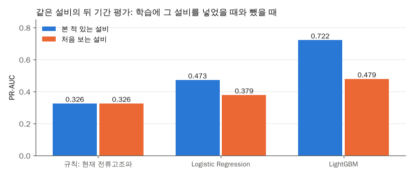

# 설비 단위 분할: 학습에 없던 설비에서도 LightGBM이 규칙보다 나은지

## 문제

지금까지는 같은 설비의 앞 기간(Training)으로 학습하고 뒤 기간(Validation)으로 평가했다. 이 방식은 모델이 "이 설비는 원래 이런 패턴"을 외워서 맞혀도 성능이 높게 나온다. 새 설비에 바로 쓸 수 있는지 보려면 학습에 없던 설비로 평가해야 한다. 같은 데이터를 쓴 이제혁(2023)은 설비 2대만 썼으므로, 이 실험이 선행 연구와 가장 크게 다른 지점이다.

코드: [scripts/08_unit_split.py](../scripts/08_unit_split.py)

## 분석 흐름

```text
설비를 5묶음으로 나눔 (양성 수 순서대로 돌아가며 배정)
→ 묶음마다 두 모델을 학습
   본 적 있는 설비: 모든 설비의 Training 기간으로 학습
   처음 보는 설비: 그 묶음을 뺀 설비의 Training 기간으로 학습
→ 두 모델 모두 그 묶음 설비의 Validation 기간으로 평가
→ 5묶음 결과를 모아 전체 지표 계산
```

평가 행이 같고 학습에 그 설비를 넣었는지만 다르므로, 두 결과의 차이가 "설비를 외운 효과"이다.

## 목표와 측정 지표

- 처음 보는 설비에서 PR-AUC가 얼마나 떨어지는가
- 그래도 단순 규칙보다 나은가
- 지표 정의는 [docs/metrics.md](../docs/metrics.md)

## 관찰

1. 30분 양성이 있는 설비는 105대 중 35대뿐이다. 무작위로 나눌 경우 사건 많은 설비가 한 묶음에 몰리는 문제가 있어, 양성 수 순서대로 묶음에 돌아가며 배정했다. 묶음별 Validation 양성은 563~1,606건이었다.
2. 419번 설비는 Training에 예측 대상 시점이 없어 묶음에 들어가지 않았다(Validation 2행). 그래서 사건 수가 355건에서 354건으로 줄었다.

## 결과



| 방법 | 본 적 있는 설비 PR-AUC | 처음 보는 설비 PR-AUC | 처음 보는 설비 사건 재현율 | 처음 보는 설비 하루 오경보 |
| --- | ---: | ---: | ---: | ---: |
| 규칙: 현재 전류고조파 | 0.326 | 0.326 | 83.9% | 13.6 |
| Logistic Regression | 0.473 | 0.379 | 82.2% | 5.9 |
| LightGBM | 0.722 | **0.479** | 80.5% | 6.3 |

묶음별 처음 보는 설비 PR-AUC는 아래와 같았다.

| 방법 | 묶음 0 | 묶음 1 | 묶음 2 | 묶음 3 | 묶음 4 |
| --- | ---: | ---: | ---: | ---: | ---: |
| 규칙: 현재 전류고조파 | 0.243 | 0.486 | **0.669** | 0.529 | 0.170 |
| Logistic Regression | 0.203 | 0.624 | 0.509 | 0.791 | 0.218 |
| LightGBM | **0.370** | **0.669** | 0.538 | **0.796** | **0.422** |

- 처음 보는 설비에서 LightGBM PR-AUC는 0.722에서 0.479로 떨어졌다. 같은 설비의 뒤 기간 평가에서 보인 차이의 상당 부분이 설비를 외운 효과였다.
- 그래도 LightGBM은 규칙(0.326)보다 0.153 높았고, 5묶음 중 4묶음에서 규칙보다 나았다. 묶음 2에서는 규칙이 더 높았다.
- 처음 보는 설비에서 LightGBM 하루 오경보는 6.3회로, 본 적 있는 설비(2.6회)보다 두 배 넘게 늘었다. 임계값을 학습 설비 기준으로 고른 탓에 새 설비 점수 분포와 어긋났다.
- 규칙은 학습이 없어 PR-AUC가 두 경우 같다. 경보 지표가 조금 다른 것은 임계값을 고른 설비 범위가 달라서이다.

## 판단

- 논문의 주 결과는 두 평가를 함께 보고한다. "본 적 있는 설비 0.722"만 보고하면 새 설비에 대한 성능을 부풀리게 된다.
- 처음 보는 설비에서도 머신러닝이 단순 규칙보다 낫다는 결론은 유지된다. 다만 차이는 0.396에서 0.153으로 줄었다.
- 묶음마다 결과 편차가 커서(LightGBM 0.370~0.796) 설비 특성에 따라 잘 맞는 설비와 안 맞는 설비가 있다. 어떤 설비에서 안 맞는지 확인할 가치가 있다.

## Trade-off

| 선택 | 대안 | 고른 이유 | 포기한 점 |
| --- | --- | --- | --- |
| 5묶음, 양성 수 순서 배정 | 설비 하나씩 빼기 | 양성 있는 설비가 35대뿐이라 하나씩 빼면 설비마다 결과가 크게 흔들림 | 묶음 구성이 결과에 영향을 줄 수 있다 |
| 묶음의 Validation 기간만 평가 | 묶음 설비의 전체 기간 평가 | 본 적 있는 설비 모델과 같은 행으로 비교하기 위함 | 평가 행이 적다 |
| 하이퍼파라미터는 07번과 같게 | 묶음마다 다시 탐색 | 설비를 외운 효과만 따로 보기 위함 | 처음 보는 설비에 맞춘 설정은 찾지 않았다 |

## 다음에 확인할 것

- 처음 보는 설비에서 성능이 낮은 묶음 0, 4의 설비 특성(정격 전류, 이상 빈도) 확인
- 새 설비의 처음 며칠 데이터로 임계값만 다시 맞추면 오경보가 줄어드는지
- 설비마다 값을 표준화한 특징(설비 평균 대비 비율)이 처음 보는 설비 성능을 올리는지
