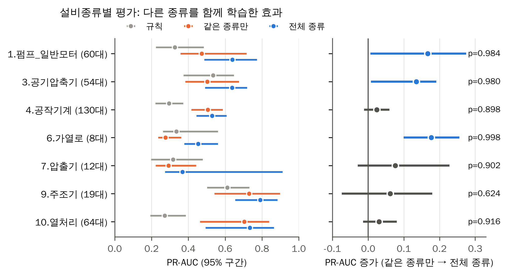

# 평가 대상 넓히기: 펌프와 추가 6종 각각을 처음 보는 설비로 평가하자, 7종 모두에서 전체 종류 학습 모델이 가장 높았음

## 문제

[다른 설비종류 추가](extra-facilities.md)와 [특징 보강](feature-extension.md)은 처음 보는 펌프/일반모터 설비만 평가했다. 다른 설비종류를 학습에 더한 효과가 펌프에서만 나타나는지, 다른 설비종류에서도 같은지는 확인하지 않았다. 7종 각각을 처음 보는 설비로 평가해, 같은 종류만 학습한 모델과 전체 종류를 학습한 모델을 비교했다.

코드: [scripts/18_widen_eval.py](../scripts/18_widen_eval.py) `--src data/features_v2`

## 분석 흐름

```text
data/features_v2 (보강 특징 167개, 7종 Training/Validation)
→ 설비종류마다 17번과 같은 방식으로 5묶음 배정
→ 묶음 설비는 Training까지 학습에서 빼고, Validation 기간으로 평가
→ 규칙 / 같은 종류만 학습 / 전체 종류 학습 비교
```

## 목표와 측정 지표

- 다른 설비종류를 함께 학습하면 펌프 외 설비종류에서도 처음 보는 설비 PR-AUC가 오르는가
- 이득이 설비 수와 어떤 관계인가
- 지표 정의는 [docs/metrics.md](../docs/metrics.md)

## 실험

### 실험 1. 설비종류별 처음 보는 설비 평가

- 평가 설비종류: 펌프/일반모터, 공기압축기, 공작기계, 가열로, 압출기, 주조기, 열처리. 공조설비, 보일러, 사출기는 양성이 적어 뺐다.
- 펌프 외 설비종류 Training은 17번과 같이 음성 20%만 표본추출하고 가중치 5로 되돌렸다.
- 조기 종료와 임계값은 평가 설비종류의 학습 설비 뒤 20%로 정했다. 표본추출한 음성을 가중치 없이 세면 정밀도가 부풀어 임계값이 낮게 잡히므로 가중치를 반영했다.
- 펌프는 17번과 같은 조건이라 결과가 재현돼야 한다. 펌프 전체 종류 0.638, 같은 종류만 0.472로 17번과 묶음별 값까지 같았다.

## 결과

| 설비종류 | 평가 설비 | 이상 있는 설비 | 규칙 | 같은 종류만 | 전체 종류 | 차이 | 앞선 묶음 |
| --- | ---: | ---: | ---: | ---: | ---: | ---: | ---: |
| 1. 펌프/일반모터 | 60 | 24 | 0.327 | 0.472 | **0.638** | +0.167 | 4/5 |
| 3. 공기압축기 | 54 | 12 | 0.534 | 0.503 | **0.637** | +0.135 | 5/5 |
| 4. 공작기계 | 130 | 51 | 0.295 | 0.505 | **0.529** | +0.024 | 4/5 |
| 6. 가열로 | 8 | 6 | 0.335 | 0.276 | **0.453** | +0.177 | 5/5 |
| 7. 압출기 | 12 | 5 | 0.317 | 0.293 | **0.368** | +0.076 | 3/5 |
| 9. 주조기 | 19 | 14 | 0.611 | 0.729 | **0.791** | +0.062 | 1/5 |
| 10. 열처리 | 64 | 35 | 0.271 | 0.704 | **0.735** | +0.031 | 4/5 |
| 7종 단순 평균 | | | 0.384 | 0.497 | **0.593** | +0.096 | 26/35 |

처음 보는 설비 PR-AUC이다. 차이는 전체 종류 − 같은 종류만, 앞선 묶음은 전체 종류가 같은 종류만보다 높았던 묶음 수이다.

| 설비종류 | 같은 종류만 F1 | 전체 종류 F1 | 같은 종류만 하루 오경보 | 전체 종류 하루 오경보 | 규칙 하루 오경보 |
| --- | ---: | ---: | ---: | ---: | ---: |
| 1. 펌프/일반모터 | 0.489 | 0.584 | 9.7 | 5.5 | 19.3 |
| 3. 공기압축기 | 0.467 | 0.598 | 3.4 | 6.6 | 6.9 |
| 4. 공작기계 | 0.535 | 0.545 | 4.0 | 4.8 | 11.2 |
| 6. 가열로 | 0.234 | 0.392 | 9.7 | 17.3 | 18.0 |
| 7. 압출기 | 0.411 | 0.427 | 13.7 | 19.4 | 23.0 |
| 9. 주조기 | 0.617 | 0.651 | 3.0 | 2.9 | 4.7 |
| 10. 열처리 | 0.612 | 0.650 | 4.3 | 4.2 | 41.9 |

- 7종 모두에서 전체 종류 학습 모델의 합산 PR-AUC가 가장 높았다. 묶음 단위로는 35개 중 26개에서 같은 종류만보다 높았다. 다른 설비종류를 더하는 효과는 펌프에만 해당하지 않았다.
- 이득은 설비가 적거나 이상 있는 설비가 적은 종류에서 컸다(가열로 +0.177, 펌프 +0.167, 공기압축기 +0.135). 설비가 많은 공작기계(130대, +0.024)와 열처리(64대, +0.031)는 같은 종류만으로도 거의 같은 성능을 냈다.
- 주조기는 합산 +0.062였지만 묶음별로는 5개 중 1개에서만 앞섰다. 양성이 가장 많은 묶음 0(0.646 → 0.801)이 합산을 끌어올렸다.
- 모델은 7종 모두에서 규칙보다 높았다. 열처리는 규칙 하루 오경보가 41.9회인데 모델은 4.2회였다.
- 가열로(8대)와 압출기(12대)는 묶음당 평가 설비가 1~3대, 압출기 묶음 3·4는 양성이 30건과 13건뿐이다. 이 두 종류의 숫자는 참고 수준이고, 하루 오경보도 17~19회로 많다.

### 설비 단위 신뢰구간

[scripts/19_unit_bootstrap.py](../scripts/19_unit_bootstrap.py) `--by facility`로 설비종류마다 평가 설비를 1,000번 다시 뽑았다(18번 `--save-scores --tag v2s`, 결과는 위 표와 같음).

| 설비종류 | 평가 설비 | 전체 종류 PR-AUC (95% 구간) | 같은 종류만 → 전체 종류 (95% 구간) |
| --- | ---: | --- | --- |
| 6. 가열로* | 8 | 0.453 (0.378~0.561) | **+0.177 (0.100~0.255)** |
| 1. 펌프/일반모터 | 60 | 0.638 (0.487~0.772) | **+0.167 (0.007~0.275)** |
| 3. 공기압축기 | 54 | 0.637 (0.491~0.719) | **+0.135 (0.008~0.191)** |
| 7. 압출기* | 12 | 0.368 (0.273~0.912) | +0.076 (−0.029~0.228) |
| 9. 주조기 | 19 | 0.791 (0.654~0.884) | +0.061 (−0.074~0.179) |
| 10. 열처리 | 64 | 0.735 (0.493~0.864) | +0.031 (−0.014~0.080) |
| 4. 공작기계 | 130 | 0.529 (0.444~0.607) | +0.024 (−0.011~0.060) |

- 이득의 구간이 0을 포함하지 않은 것은 가열로, 펌프, 공기압축기 3종이다. 나머지 4종도 방향은 모두 양수였다.
- 공기압축기와 가열로는 같은 종류만 학습하면 규칙보다 낮았는데, 전체 종류 학습으로 규칙을 넘었다.
- 주조기는 묶음별로 엇갈린 결과(5개 중 1개만 앞섬)와 같이 가장 불확실했다.
- *가열로는 평가 설비가 8대뿐이라 구간이 좁게 나와도 설비 구성이 바뀌면 달라질 수 있다.



오른쪽 패널에서 파랑(구간이 0을 포함하지 않음)은 펌프, 공기압축기, 가열로 세 종류다. 공기압축기와 가열로는 같은 종류만 학습한 모델(주황)이 규칙(회색)보다 낮았는데, 전체 종류로 학습하자 규칙을 넘었다.

## 판단

- 주 모델 학습은 전체 종류(펌프 + 6종)로 유지한다. 7종 모두에서 같은 종류만 학습한 모델보다 낮지 않았다.
- 논문에서는 처음 보는 설비 PR-AUC를 펌프(0.638) 외에 설비가 충분한 공기압축기, 공작기계, 주조기, 열처리까지 함께 보고한다. 가열로와 압출기는 표본이 작다는 단서를 붙인다.
- "설비가 적은 종류일수록 다른 종류를 함께 학습한 이득이 크다"를 결론 하나로 쓴다. 신뢰구간으로 확실한 것은 가열로, 펌프, 공기압축기이고, 설비가 많은 공작기계·열처리는 같은 종류만으로도 비슷했다고 함께 적는다.

## Trade-off

| 선택 | 대안 | 고른 이유 | 포기한 점 |
| --- | --- | --- | --- |
| 설비종류마다 따로 5묶음 | 7종을 섞어 5묶음 | 종류별 결과를 따로 볼 수 있고 펌프 결과가 17번과 그대로 이어짐 | 설비가 적은 종류는 묶음당 1~3대뿐이다 |
| 임계값을 평가 설비종류 학습 설비로 정함 | 전체 종류 학습 설비로 정함 | 설비종류마다 점수 분포가 달라 임계값이 어긋나는 것을 막음 | 가열로, 압출기는 보정 설비가 적어 임계값이 흔들린다 |
| 보조 라벨 3종(공조, 보일러, 사출기) 제외 | 함께 평가 | 30분 양성이 거의 없거나 라벨 경계가 덜 맞음 | 10종 중 3종은 결론에 들어가지 않는다 |

## 다음에 확인할 것

- 설비종류별 2분 대기 경보 결과 (`data/results/widen_v2_alarm.csv`)
- 새 설비 초기 며칠로 임계값만 다시 맞추는 방식: [model-comparison-v2.md](model-comparison-v2.md)에서 효과 없음을 확인함
