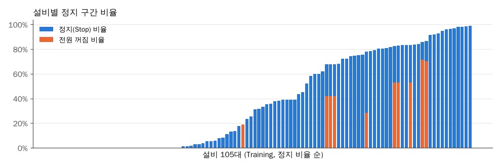

# EDA: 1차 전처리 결과의 결측, 이상값, 라벨 분포 점검

## 문제

1차 전처리로 설비 105대의 JSON을 설비별 표 210개(Training, Validation 각 105개)로 바꿨지만, 값이 얼마나 비어 있는지, 센서가 이상한 값을 내는 구간이 있는지, 라벨이 어떤 기준으로 붙었는지는 보지 않은 상태였다. 2차 전처리 기준을 정하기 전에 210개 파일 394만 행 전체를 한 번에 훑었다.

코드: [scripts/02_eda.py](../scripts/02_eda.py). 결과 표는 `data/eda/`(git 제외), 그래프는 [charts/](../charts/)에 저장된다.

## 분석 흐름

```text
설비별 parquet 210개
→ 하나로 합치기 (split, 설비종류, 설비번호 컬럼 추가)
→ 시간 간격, 결측, 0값, 음수값, 측정 상한값 집계 (설비별 / 컬럼별)
→ 라벨 분포와 라벨끼리의 관계
→ 2차 전처리 기준 정리
```

## 관찰

### 1. 시간 간격과 결측

1. 측정 간격의 99.9%가 정확히 60초였다. 2분 간격이 1,840곳 있었는데 대부분 바로 다음 행이 1초 뒤에 찍혀 있어서, 수집 지연으로 한 행이 밀린 것이었다.
2. 1시간 넘게 끊긴 곳은 73곳이었고, 대부분 2021-01-23 ~ 2021-02-08 사이에 여러 설비에서 같이 끊겼다. 설비 고장보다 수집 서버 쪽 중단으로 봤다.
3. 측정값이 NaN인 행은 5,028행뿐이었다. 대부분 459번(2,783행), 69번(1,440행), 461번(784행)에서 상별 항목만 하루 정도 통째로 빠진 경우였고, 평균 항목 11개는 11행만 비어 있었다.
4. 같은 시각이 두 번 들어간 행은 없었다.

### 2. 측정 상한값과 튀는 값

| 현상 | 행 수 | 설비 | 판단 |
| --- | ---: | --- | --- |
| 상별 전류가 정확히 512 A | 10 | 69, 484, 503번 | 정지 → 운전으로 바뀌는 첫 1분에만 나옴. 돌입전류가 센서 상한에서 잘린 값 |
| 상별 전류 4095.94 A | 4 | 69번 | 같은 기동 순간에 512와 같이 찍힘. 12비트 상한값 |
| 상전압 940~999 V | 17 | 484, 486번 | 정격 220/440 V 설비에서 1분만 튐 |
| 주파수 164~172 Hz, 상전압 97 V | 13,812 | 548번 Training 1/19~1/28 | 설비 이름이 "인버터1동력"이고 이 기간 유효전력이 거의 0. 계측 설정이 달랐던 구간 |
| 주파수 20 Hz, 상전압 7 V | 20,911 | 299~301번 | 전원이 꺼진 동안 찍힌 잔류값. 전류와 전력은 0 |

512 A는 작업일지에서 의심했던 값이다. 아래 그림처럼 기동 순간 한 점만 튀고 바로 정상 운전 전류로 돌아온다.


### 3. 음수값

1. 역률 -1은 28행뿐이었다. 대부분 467번(23행)에서 전류 4.6 A 정도의 저부하 때 나왔다.
2. 유효전력이 음수인 행은 0.6%였고, 거의 모두(99.98%) 역률도 음수인 행이었다. 363, 406, 467, 548번처럼 특정 설비에 몰려 있어서 CT(변류기) 방향이 반대로 달렸거나 역송전이 있는 설비로 봤다.
3. 누적전력량이 음수인 설비가 3대(290, 406, 467번) 있었다. 467번은 95%가 음수여서 계량기 기준값이 설비마다 다르다고 봤다. 누적값 자체보다 차분(1분 증가량)을 써야 한다.
4. 온도 음수는 0.4%였고 11~12월 새벽(2~8시)에 몰려 있어 실제 기온으로 봤다.

### 4. 정지 구간

1. 기동 라벨(전류 기준)은 Stop 41.6%, Loading 34.6%, Unloading 23.8%였다. 처음 생각과 달리 라벨은 2종이 아니라 Unloading(무부하 운전)까지 3종이었다.
2. Training 105대 중 30대는 Stop이 한 번도 없었고, 24대는 80% 이상이 Stop이었다.
3. 전원이 아예 꺼진 행(상전압평균 50 V 미만)은 4.9%였다. Validation 80번은 100%가 꺼진 상태였다.
4. Stop 라벨인데 전류가 0보다 큰 행이 Stop의 9.6%였다(중앙값 2.1 A). 대기 전류로 보인다.



### 5. SOH 라벨

1. 역률 SOH 라벨은 Stop 구간의 93%가 "경고"였다. 멈춰 있으면 역률이 0으로 찍히기 때문에 생긴 라벨이고, 설비 상태와는 관계가 없다.


2. 운전 구간에서 SOH 라벨은 기준 항목의 값만으로 거의 그대로 나뉘었다. 라벨별 2~98% 구간을 보고 아래 경계를 잡았더니 97~99%가 일치했다.

| 라벨 | 정상 | 주의 | 경고 | 경계로 재현한 비율 |
| --- | --- | --- | --- | ---: |
| 역률평균 | 0.8 이상 | 0.6 ~ 0.8 | 0.6 미만 | 97.4% |
| 전류고조파평균 | 30 미만 | 30 ~ 60 | 60 이상 | 99.1% |
| 전압고조파평균 | 3 미만 | 3 ~ 5 | 5 이상 | 98.2% |


## 해석

1. SOH 라벨은 같은 시각의 평균값에 경계를 적용해 붙인 규칙 라벨이다. 그 항목을 입력에 넣고 같은 시각의 SOH를 맞히면 경계만 배우게 된다. 모델을 만들 때는 기준 항목을 입력에서 빼거나, 앞 시간 데이터로 다음 상태를 예측하는 문제로 바꿔야 한다.
2. 역률 SOH는 Stop 구간에서 의미가 없으므로 SOH 분석은 운전 구간(Loading, Unloading)만 쓴다.
3. 결측과 이상값은 전체의 1% 미만이고 몇몇 설비에 몰려 있다. 행 단위로 지우기보다 해당 값만 결측으로 바꾸고 표시하는 쪽이 시계열을 덜 깨뜨린다.

## 2차 전처리로 넘긴 기준

| 항목 | 기준 | 근거 |
| --- | --- | --- |
| 시간 격자 | 분 단위로 내리고 빈 분은 행 추가 | 2분 간격 1,840곳이 대부분 수집 지연 |
| 측정 상한값 | 전류 512, 4095 이상은 결측 | 기동 순간에만 나오는 잘린 값 |
| 전압 튐 | 상전압 500 V, 선간전압 800 V 초과는 결측 | 정격 최대 440 V |
| 주파수 이상 | 전원이 들어온 상태에서 55~65 Hz 밖이면 측정값 전체 결측 | 548번 계측 설정 오류 구간 |
| 전원 꺼짐 | 상전압평균 50 V 미만 | 299~301번 잔류값 7 V |
| 설비 제외 | 전원 꺼짐 95% 이상 | Validation 80번 |
| 음수 전력, 역률 | 유지 | 설비별로 일관된 부호라 측정 방향 문제로 봄 |
| 정지 구간 | 유지하고 표시만 | 기동 패턴 분석에는 필요 |

자세한 처리 방법은 [preprocessing.md](preprocessing.md#2차-전처리)에 정리했다.

## 다음에 확인할 것

- 음수 유효전력 설비(363, 406, 467, 548번)를 부호 반전으로 맞출지, 절댓값을 쓸지 정하기
- Stop 중 대기 전류가 있는 구간을 따로 볼지 정하기
- SOH를 예측 문제로 쓸 때 기준 항목을 뺀 입력으로 얼마나 맞히는지 확인하기
